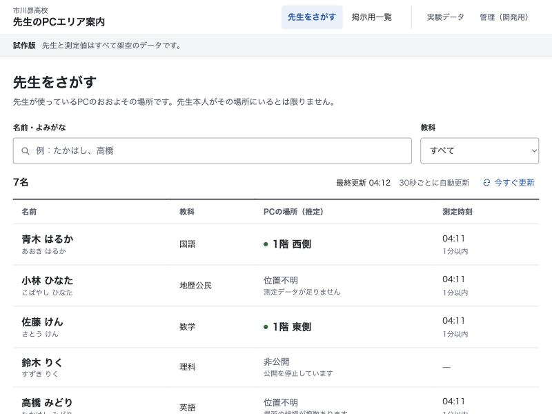

# 市川昴高校 教員PCエリア案内・研究プロトタイプ

既存Wi-Fiを利用した大まかなPC所在エリア推定を研究する、ローカルで動く実験基盤とWebアプリです。**学校で測ったデータや実在する教員情報は使っていません。推定対象はPCであり、先生本人の現在地を保証しません。** 外部公開・学校ネットワークへの接続は行いません。

指定の研究メモは作業開始時に存在せず、依頼文を基に空のフォルダから作成しました。設計判断は[実装計画](docs/IMPLEMENTATION_PLAN.md)、実行結果は[結果](docs/RESULTS.md)に記録しています。 後から提供された[研究メモ原文](ichikawa_subaru_wifi_location_research_memo.md)も保存し、実験番号・Phaseの違いと未実施項目を[対応表](docs/MEMO_ALIGNMENT.md)に整理しました。

## 画面

名前・よみがな・教科で検索し、PCのおおよその場所と測定時刻を確かめる名簿形式です。白地に濃い文字、アクセントは青1色にして、文字の大きさとコントラストを優先しました。スマートフォンでは1人分ずつ縦に並べます。[画面設計の考え方](docs/UI_DESIGN.md)。



## できること

- 4 AP・6エリアの再現可能な模擬RSSI生成、長形式CSVとUJIIndoorLoc読込
- 接続AP、最強AP、1-NN、k-NN、距離重み付きk-NN、順位、Gaussian分類
- 平均、中央値、頑健平均、EMA、一次元カルマンフィルタの比較
- AP選択、欠損・未知パターン・候補競合・古い測定による`unknown`判定
- A〜Nの比較、端末/日時別評価、7種類のPNGグラフとCSV/JSON/Markdown出力
- 架空教員の名前・よみがな・教科検索（ひらがな/カタカナ・全角/半角を区別しない、五十音順）
- 職員室前向けの掲示用一覧（大きな文字・時計・全画面表示）
- 管理画面：架空の先生の登録・削除・非公開、模擬RSSIの投入、推定方式とAP対応表の変更
- 研究画面：模擬データとUJIIndoorLocの結果の切り替え、APごとのRSSIと受信状況
- FastAPI + SQLiteの最新観測1件保存。非公開時に測定を削除し、追加保存も停止。保持期間を過ぎた測定は自動削除
- 起動ごとに生成する管理トークン、Hostヘッダー検査、CSPなどのセキュリティヘッダー、送信サイズの上限

今回の[品質改善](docs/IMPROVEMENTS.md)では、通信復旧・入力保持・データの一括保存・推定の境界条件を修正し、GitHub Actionsによる自動テストを追加しました。

## 環境

Vivobookで使用する環境は **Ubuntu Server 26.04 LTS（amd64）・CPython 3.13.18・Node.js 24** です。従来のmacOS/Python 3.12開発環境とUbuntu 24.04/Python 3.12の設置手順も利用できます。Node 22.12以上の対応版またはNode 24を使用してください。検証済みのPython依存は`requirements.lock`、JavaScript依存は`frontend/package-lock.json`に固定しています。

### ASUS Vivobook 16 を常設サーバーにする

V3607VUではOS標準のPythonとアプリ用の **CPython 3.13.18** を分けます。新規導入用に、公式ソースのハッシュを検証してアプリ用Pythonを配置するスクリプトを同梱しています。systemdがこのアプリを起動し、SQLiteのデータをリリースとは別の場所に保存します。初回は、このprivateリポジトリを読める管理PCから `deploy/` を渡し、Vivobookが生成する公開鍵をリポジトリの読み取り専用Deploy keyとして登録します。以後はVivobookで `sudo wifi-location-update` を実行すればGitHubから更新できます。

使用するAPの申告型番は **Cisco AIR-AP1832I-Q-K9C** です。管理方式と接続端末情報の確認手順は[APの資料](docs/NETWORK.md)を参照してください。

OSを入れる前のWindowsのバックアップ、初回転送のコマンド、鍵の登録先、SSHトンネルでの画面の開き方、更新・復旧の手順は[サーバー設置ガイド](docs/SERVER.md)にまとめています。

## 最初のセットアップ（macOS / Linux）

以下はPython 3.12を使う開発環境の例です。プロジェクトのルートで実行します。Vivobookへの常設には上のサーバー設置ガイドを使用してください。

```bash
python3.12 -m venv .venv
.venv/bin/python -m pip install -r requirements.lock
.venv/bin/python -m pip install --no-deps -e .
npm --prefix frontend ci
```

ビルドに必要なsetuptoolsはpipが隔離環境で用意します。インターネット接続は依存パッケージと公開データの取得にだけ必要です。

## 起動（ブラウザとAPIを1つのサーバーで動かす）

```bash
npm --prefix frontend run build
.venv/bin/python -m uvicorn wifi_location.api:app --host 127.0.0.1 --port 8000
```

[http://127.0.0.1:8000](http://127.0.0.1:8000)を開きます。API仕様は[http://127.0.0.1:8000/docs](http://127.0.0.1:8000/docs)。停止はCtrl+C。フロントのビルド後にバックエンドを起動してください。ビルドがない状態ではAPIだけが動きます。

新規DBの初回は架空教員6名を自動登録します。全員を削除しても再起動で復活しません。初期表示には非公開、古い測定、測定不足を含みます。データは3分で無効になるため、「管理（開発用）」→「模擬データを更新」で新しい模擬観測を投入してください。生徒画面の「今すぐ更新」は再取得のみを行い、測定の時刻を新しくしません。エリア名・推定方式の取得失敗は独立して表示し、「設定を再読み込み」で復旧できます。自動更新は30秒間隔で、タブを表示していない間は止まり、戻ったときにすぐ取得します。通信停止中も古いエリアを表示し続けないよう、画面側でも鮮度を確認します。

管理画面のトークンは、`WIFI_ADMIN_TOKEN`を設定しない場合、起動するたびにランダムに作られ、ターミナルに次のように表示されます。「管理（開発用）」でこの値を入力して接続します。

```text
[wifi-location] 管理画面のトークン（この起動中のみ有効）: （ランダムな文字列）
```

固定したい場合は、半角の英数字と記号だけで16文字以上の値を`WIFI_ADMIN_TOKEN`に設定してください（全角文字や空白はHTTPヘッダーで送れないため、起動時にエラーにします）。以前の固定値`dev-demo-token`は既定では使われません。トークンは画面のメモリ内だけで保持し、ブラウザの保存領域には書きません（再読み込みで消えます）。生徒用レスポンスには端末IDやRSSIを含めません。研究画面は模擬データと公開データの集計だけを返します。実運用の認証やアクセス制御は未実装です。

サーバーは`127.0.0.1`・`localhost`・`[::1]`というホスト名でのアクセスだけに応答します（悪意のあるWebページが名前解決を差し替えてローカルのAPIを操作する「DNSリバインディング」への対策）。別のホスト名やIPアドレスで開く場合は、`WIFI_ALLOWED_HOSTS=127.0.0.1,localhost,192.168.0.10`のようにカンマ区切りで指定します（ポート番号は無視し、IPv6は`::1`と書いても`[::1]`として扱います）。

SQLiteの既定保存先は`data/demo.sqlite3`。別の空の実験DBで起動するには`WIFI_DB_PATH`環境変数でファイルを指定します。教員情報・端末対応と最新観測のみを保存し、移動履歴テーブルは作りません。測定から3分で表示を無効にし、保持期間（`WIFI_RETENTION_SECONDS`、既定3600秒、最大10年）を過ぎた最新測定は1分ごとにDBから削除します。保持期間より古い日時の測定は受け付けません。保持期間は仮の値で、実運用では学校との合意が必要です。以前のDBは起動時に「よみがな」列を追加して移行し、架空教員6名のよみがなを補います。

### フロントエンドの開発

バックエンドを8000番で起動したまま、別のターミナルで以下を実行します。

```bash
npm --prefix frontend run dev
```

表示されたローカルURLを開きます。Viteが`/api`を8000番に転送します。

### Windows（PowerShell）

```powershell
py -3.12 -m venv .venv
.\.venv\Scripts\python.exe -m pip install -r requirements.lock
.\.venv\Scripts\python.exe -m pip install -e . --no-deps
npm --prefix frontend ci
npm --prefix frontend run build
.\.venv\Scripts\python.exe -m uvicorn wifi_location.api:app --host 127.0.0.1 --port 8000
```

以降の`.venv/bin/python`はWindowsでは`.\.venv\Scripts\python.exe`に読み替えます。Windows実機での起動・無線取得は未確認です。

## 比較実験

```bash
.venv/bin/python -m wifi_location.experiments --seed 42 --output results/latest
```

1,152件を生成し、静止測定バッチを学習672件・閾値検証192件・テスト288件に分けます。端末や日付を分離した追加評価も行います。出力は[自動レポート](results/latest/REPORT.md)、`summary.json`、集計CSV、`predictions.csv`、観測CSV、PNG7枚です。プログラムは実ネットワークを使用しません。

カルマン等のパラメータは変更できます。別の出力フォルダを使い、最終テスト結果を見ながら調整しないでください。

```bash
.venv/bin/python -m wifi_location.experiments --seed 42 --q 0.5 --r 25 --window 7 --alpha 0.25 --output results/parameter-trial
```

Webは最新の1観測を推定し、既定ではその結果を表示します。このブランチでは、表示前に同じエリア候補を新しい観測で確認するFSMを選べます。`WIFI_FSM_ENABLED=1` を指定し、単一ワーカーで起動してください。確認中や候補変更時はエリアを隠し、非公開を最優先にします。確認回数は `WIFI_FSM_CONFIRMATIONS` で変更できます。状態はメモリ内だけに置き、再起動時は未確定に戻ります。[FSMの設計・起動例](docs/FSM_DESIGN.md)

FSMの比較実験は `.venv/bin/python -m wifi_location.fsm_experiments --output results/fsm` で再現できます。既存方式・連続判定・FSM・カルマン併用を、分離した調整用と最終評価用の複数シードで比較します。誤表示率、位置不明率、確認待ち時間を併せて報告します。[比較条件](docs/FSM_EXPERIMENTS.md)・[実行結果](docs/FSM_RESULTS.md)

時系列フィルタの比較は独立した静止研究セッションで行います。WebのDBは最新観測1件を保存し、FSMを使う場合も教員の系列履歴を蓄積しません。

## UJIIndoorLoc（独立した公開データ）

```bash
.venv/bin/python scripts/download_uji.py
.venv/bin/python scripts/experiment_uji.py
```

取得は公開UCIサーバーのみです。元CSVは大きいためGit管理対象外とし、再取得用スクリプト・出典・SHA-256を保存しています。今回の作業環境には取得済みです。ライセンスはCC BY 4.0。対象は大学の建物/階で、学校6エリアの模擬データとは別に評価します。[データ条件](data/ujindoorloc/README.md)、[独立評価レポート](results/uji/REPORT.md)。

## CSV入力・推定器の使い方

長形式の必須列は`timestamp,area,ap_id,rssi,source,device_id,session_id`。任意列`connected_ap`。RSSIはdBm、タイムゾーン付き日時を指定します。1観測の複数APを複数行に記録し、同じ日時・端末・セッション・方式でまとめます。APがない観測はAP/RSSIの両方を空欄にします。不正値・重複AP・矛盾したメタデータは行番号付きエラーになり、黙って無視しません。

```python
from wifi_location.sources import read_csv
from wifi_location.algorithms import Engine
from wifi_location.simulation import AP_AREAS

observations = read_csv("results/latest/observations.csv")
training = [o for o in observations if o.session_id.startswith("sim-s00-")]
query = next(o for o in observations if o.session_id.startswith("sim-s01-"))
model = Engine(training, AP_AREAS, algorithm="knn", k=3)
# オフライン評価では測定時点を基準にする。Webは現在時刻で鮮度を判定する。
print(model.predict(query, now=query.timestamp))
```

実測を取り込む場合は、収集許可の後に別の`source`を使用して独立モデルを作ります。公開・模擬・実測を無検証で混ぜることはエンジンが拒否します。今のWeb投入APIは模擬データ専用です。

## テスト

```bash
.venv/bin/python -m pytest -q
npm --prefix frontend test
npm --prefix frontend run build
```

push・PR時にはGitHub ActionsでPython・画面のテストとビルドを実行します。Ubuntu 26.04と24.04の使い捨てVMでは、そのコミットをローカルGitリモートから取得し、実際のsystemdサービス、Web/API、SSH鍵の分離、LANの公開範囲、SQLiteのバックアップ・復元も確認します。StarletteのTestClientがhttpxの将来廃止に関する警告を1件出しますが、テストは動作しています。従来版では名前・よみがな・教科検索、登録・削除、測定投入、非公開、掲示用一覧、研究画面のデータ切り替え、375px幅を実ブラウザでも確認しました。今回の改善後はブラウザへのアクセス許可が拒否されたため、実ブラウザでの再確認は行っていません。[確認記録](docs/VERIFICATION.md)。

## ファイル案内

|場所|役割|
|---|---|
|`src/wifi_location/`|型、生成、読込、前処理、AP選択、推定、評価、API|
|`frontend/src/`|`App.tsx`（画面の切り替えと一覧の定期取得）、`views/`（画面ごとの部品）、`lib/`（検索・時刻・鮮度判定）、`components/`（グラフ・アイコン）、画面テスト|
|`tests/`|数値・欠損・未知・CSV・API・評価分割のテスト|
|`results/latest/`|模擬実験のデータ・指標・グラフ・自動レポート|
|`results/uji/`|UJIの独立評価|
|`docs/`|要件・設計・研究・結果・ネットワーク・情報管理・学校質問|

[学校への確認事項](docs/SCHOOL_QUESTIONS.md)では、機種・構成・管理API・RADIUS・同意・公開先・保持期間などを整理しています。AP情報取得と学校性能は未検証です。次は[開発計画](docs/NEXT_STEPS.md)に従い、複数シードや独立した未知エリアを評価し、許可後に別端末・別日付の実測PoCを行います。
