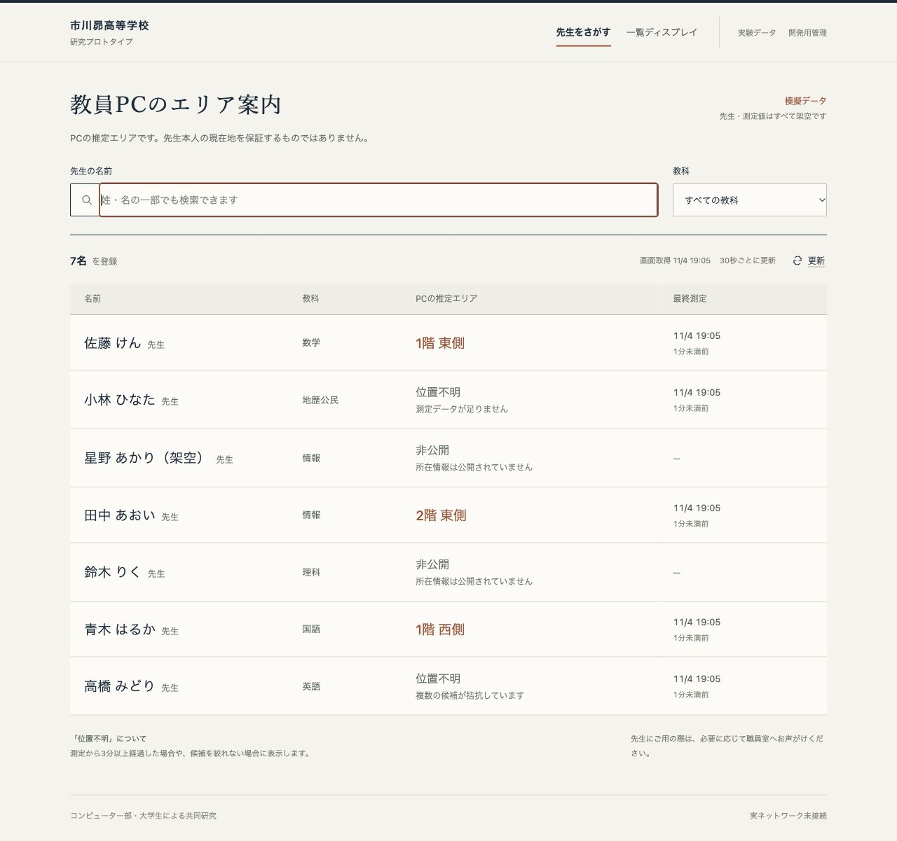

# 市川昴高校 教員PCエリア案内・研究プロトタイプ

既存Wi-Fiを利用した大まかなPC所在エリア推定を研究する、ローカルで動く実験基盤とWebアプリです。**学校で測ったデータや実在する教員情報は使っていません。推定対象はPCであり、先生本人の現在地を保証しません。** 外部公開・学校ネットワークへの接続は行いません。

指定の研究メモは作業開始時に存在せず、依頼文を基に空のフォルダから作成しました。設計判断は[実装計画](docs/IMPLEMENTATION_PLAN.md)、実行結果は[結果](docs/RESULTS.md)に記録しています。

## 画面

検索からエリアと測定時刻を確認できる名簿形式です。PCでは4列、スマートフォンでは行内の情報を縦に組み替えます。[画面設計の考え方](docs/UI_DESIGN.md)。



## できること

- 4 AP・6エリアの再現可能な模擬RSSI生成、長形式CSVとUJIIndoorLoc読込
- 接続AP、最強AP、1-NN、k-NN、距離重み付きk-NN、順位、Gaussian分類
- 平均、中央値、頑健平均、EMA、一次元カルマンフィルタの比較
- AP選択、欠損・未知パターン・候補競合・古い測定による`unknown`判定
- A〜Nの比較、端末/日時別評価、7種類のPNGグラフとCSV/JSON/Markdown出力
- 架空教員の名前・教科検索、一覧ディスプレイ、管理画面、研究画面
- FastAPI + SQLiteの最新観測1件保存。非公開時に測定を削除し、追加保存も停止

## 環境

検証環境はmacOS、Python **3.12.14**、Node **24.21.0**です。Python 3.12を推奨します（Python 3.15は対象外）。Node 22.12以上の対応版またはNode 24を使用してください。検証済みのPython依存は`requirements.lock`、JavaScript依存は`frontend/package-lock.json`に固定しています。

## 最初のセットアップ（macOS / Linux）

プロジェクトのルートで実行します。

```bash
python3.12 -m venv .venv
.venv/bin/python -m pip install -r requirements.lock
.venv/bin/python -m pip install --no-deps -e .
npm --prefix frontend ci
```

ビルドに必要なsetuptoolsはpipが隔離環境で用意します。インターネット接続は依存パッケージと公開データの取得にだけ必要です。

## 起動（ブラウザとAPIを1つのサーバーで動かす）

```bash
npm --prefix frontend run build
.venv/bin/python -m uvicorn wifi_location.api:app --host 127.0.0.1 --port 8000
```

[http://127.0.0.1:8000](http://127.0.0.1:8000)を開きます。API仕様は[http://127.0.0.1:8000/docs](http://127.0.0.1:8000/docs)。停止はCtrl+C。フロントのビルド後にバックエンドを起動してください。ビルドがない状態ではAPIだけが動きます。

初回は架空教員6名を自動登録します。初期表示には非公開、古い測定、測定不足を含みます。データは3分で無効になるため、「開発用管理」→「模擬データを更新」で新しい模擬観測を投入してください。生徒画面の更新ボタンは再取得のみを行い、測定の時刻を新しくしません。自動更新は30秒間隔です。通信停止中も古いエリアを表示し続けないよう、画面側でも鮮度を確認します。

開発管理APIの初期トークンは`dev-demo-token`です。これはローカルの架空データ専用です。`WIFI_ADMIN_TOKEN`環境変数で変更でき、画面の入力欄に同じ値を設定します。生徒用レスポンスには端末IDやRSSIを含めません。研究画面は模擬データだけを返します。実運用の認証やアクセス制御は未実装です。

SQLiteの既定保存先は`data/demo.sqlite3`。別の空の実験DBで起動するには`WIFI_DB_PATH`環境変数でファイルを指定します。教員情報・端末対応と最新観測のみを保存し、移動履歴テーブルは作りません。古い最新レコードの自動削除はまだなく、表示を無効にする処理と保存期間は区別しています。

### フロントエンドの開発

バックエンドを8000番で起動したまま、別のターミナルで以下を実行します。

```bash
npm --prefix frontend run dev
```

表示されたローカルURLを開きます。Viteが`/api`を8000番に転送します。

### Windows（PowerShell）

```powershell
py -3.12 -m venv .venv
.\.venv\Scripts\python.exe -m pip install -r requirements.lock
.\.venv\Scripts\python.exe -m pip install -e . --no-deps
npm --prefix frontend ci
npm --prefix frontend run build
.\.venv\Scripts\python.exe -m uvicorn wifi_location.api:app --host 127.0.0.1 --port 8000
```

以降の`.venv/bin/python`はWindowsでは`.\.venv\Scripts\python.exe`に読み替えます。Windows実機での起動・無線取得は未確認です。

## 比較実験

```bash
.venv/bin/python -m wifi_location.experiments --seed 42 --output results/latest
```

1,152件を生成し、静止測定バッチを学習672件・閾値検証192件・テスト288件に分けます。端末や日付を分離した追加評価も行います。出力は[自動レポート](results/latest/REPORT.md)、`summary.json`、集計CSV、`predictions.csv`、観測CSV、PNG7枚です。プログラムは実ネットワークを使用しません。

カルマン等のパラメータは変更できます。別の出力フォルダを使い、最終テスト結果を見ながら調整しないでください。

```bash
.venv/bin/python -m wifi_location.experiments --seed 42 --q 0.5 --r 25 --window 7 --alpha 0.25 --output results/parameter-trial
```

Webは最新の1観測を直接推定します。時系列フィルタの比較は独立した静止研究セッションで行い、Webに教員の系列履歴は蓄積しません。実験の構成とWebの処理が同一であるとは扱いません。

## UJIIndoorLoc（独立した公開データ）

```bash
.venv/bin/python scripts/download_uji.py
.venv/bin/python scripts/experiment_uji.py
```

取得は公開UCIサーバーのみです。元CSVは大きいためGit管理対象外とし、再取得用スクリプト・出典・SHA-256を保存しています。今回の作業環境には取得済みです。ライセンスはCC BY 4.0。対象は大学の建物/階で、学校6エリアの模擬データとは別に評価します。[データ条件](data/ujindoorloc/README.md)、[独立評価レポート](results/uji/REPORT.md)。

## CSV入力・推定器の使い方

長形式の必須列は`timestamp,area,ap_id,rssi,source,device_id,session_id`。任意列`connected_ap`。RSSIはdBm、タイムゾーン付き日時を指定します。1観測の複数APを複数行に記録し、同じ日時・端末・セッション・方式でまとめます。APがない観測はAP/RSSIの両方を空欄にします。不正値・重複AP・矛盾したメタデータは行番号付きエラーになり、黙って無視しません。

```python
from wifi_location.sources import read_csv
from wifi_location.algorithms import Engine
from wifi_location.simulation import AP_AREAS

observations = read_csv("results/latest/observations.csv")
training = [o for o in observations if o.session_id.startswith("sim-s00-")]
query = next(o for o in observations if o.session_id.startswith("sim-s01-"))
model = Engine(training, AP_AREAS, algorithm="knn", k=3)
# オフライン評価では測定時点を基準にする。Webは現在時刻で鮮度を判定する。
print(model.predict(query, now=query.timestamp))
```

実測を取り込む場合は、収集許可の後に別の`source`を使用して独立モデルを作ります。公開・模擬・実測を無検証で混ぜることはエンジンが拒否します。今のWeb投入APIは模擬データ専用です。

## テスト

```bash
.venv/bin/python -m pytest -q
npm --prefix frontend test
npm --prefix frontend run build
```

Python64件、画面15件が成功。StarletteのTestClientがhttpxの将来廃止に関する警告を1件出しますが、テストは動作しています。名前・教科検索、登録、測定投入、方式変更、非公開、一覧、研究画面、390px幅を実ブラウザでも確認しました。[確認記録](docs/VERIFICATION.md)。

## ファイル案内

|場所|役割|
|---|---|
|`src/wifi_location/`|型、生成、読込、前処理、AP選択、推定、評価、API|
|`frontend/`|React/TypeScript画面と画面テスト|
|`tests/`|数値・欠損・未知・CSV・API・評価分割のテスト|
|`results/latest/`|模擬実験のデータ・指標・グラフ・自動レポート|
|`results/uji/`|UJIの独立評価|
|`docs/`|要件・設計・研究・結果・ネットワーク・情報管理・学校質問|

[学校への確認事項](docs/SCHOOL_QUESTIONS.md)では、機種・構成・管理API・RADIUS・同意・公開先・保持期間などを整理しています。AP情報取得と学校性能は未検証です。次は[開発計画](docs/NEXT_STEPS.md)に従い、複数シードや独立した未知エリアを評価し、許可後に別端末・別日付の実測PoCを行います。
