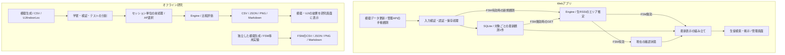

# システム構成

mainには、最新のPCエリアを表示するWebアプリと、推定方式を比較するオフライン研究プログラムがある。両者は観測型と推定器を共有する。Webは最新1件の生RSSIを使い、研究用の時系列フィルタを保持しない。FSMはmainに統合済みで、既定では無効である。

図のWeb側では、新しい観測の保存時にFSM用の推定を行い、DBコミット後に確認状態をメモリへ反映する。FSM無効時はGETで最新観測を推定する。FSM有効時の生徒向けGETは確認状態を読み、鮮度だけを再判定する。図にある収集入口は模擬・手動入力であり、AP API・SNMP・RADIUS・Windowsからの自動収集は未接続である。研究画面が読むのは基本の模擬実験とUJIの結果で、FSMの比較結果は独立したファイルで参照する。

## モジュールの責務

|場所|役割|
|---|---|
|`models.py`|共通の観測 `Observation` と推定結果 `Estimate`|
|`sources.py` / `simulation.py`|CSV・公開データの読込、再現可能な模擬観測|
|`filters.py` / `selection.py`|研究用の因果的RSSI前処理、AP選択|
|`algorithms.py`|エリア分類、鮮度・観測不足・未知パターン・候補差の判定|
|`state_machine.py`|表示を確認中・確定・不明・期限切れへ遷移させる純粋関数|
|`experiments.py` / `fsm_experiments.py`|基本比較とFSM比較の分割・調整・評価・出力|
|`api.py`|入力検証、認証、SQLite、公開項目の制限、推定器とFSMの接続|
|`frontend/src/App.tsx` / `views/`|画面切替、一覧の定期取得、検索・掲示・管理・研究画面|
|`frontend/src/lib/` / `components/`|検索・鮮度・時刻の共通処理、グラフなどの表示部品|
|`deploy/`|Ubuntuへの配置、更新、systemd、任意の生徒向けLANプロキシ|

フロントエンドにエリア分類やFSMの確認回数を複製しない。生徒一覧の取得は通常30秒間隔で、非表示タブでは停止する。APIとは別に画面側でも測定時刻を判定し、通信停止中に古いエリアを表示し続けない。実際の端末スリープ中には処理できないため、復帰時の再取得・再描画も確認対象になる。

## 観測・推定・表示の境界

`Observation` はタイムゾーン付き測定日時、AP→RSSI辞書、仮名端末ID、測定セッションID、収集方式、任意の正解エリアと接続APを持つ。接続APだけの観測と、複数APのRSSIを区別する。`Estimate` は候補エリアまたは `unknown`、理由、候補スコア、距離を返す。スコアはモデル内の相対支持であり、正解確率ではない。

Webの学習指紋は起動時に作る模擬データである。CSV/UJIによる研究結果の表示は、このWeb推定器を学校向けモデルへ置き換える機能ではない。現行WebのEngineは最大距離16、候補差は通常0.25（順位方式0、Gaussian方式0.1）を用いる。これらは実験用の仮置きであり、`Engine` クラス単体の既定値や、各研究実験で調整した値とも区別する。

公開APIは生徒用の型へ変換し、管理用の端末ID・AP・RSSIを返さない。非公開ではエリアだけでなく測定時刻と理由も隠す。180秒以上古い観測、または現在より5秒を超えて未来の観測は表示しない。この境界はAPIと画面で共通である。

## FSMと保存の整合性

`observe` と `expire` は `UNKNOWN`、`CANDIDATE`、`CONFIRMED`、`STALE` の新しい状態を返す。`WIFI_FSM_ENABLED=1` のとき、新しい有効な観測だけを確認回数へ数え、`CONFIRMED` だけを生徒APIの `located` に対応させる。確認中は候補名を公開せず `unknown` を返す。設定値・遷移条件は [FSM設計](FSM_DESIGN.md) を参照する。

|操作|最新観測と確認証拠の扱い|
|---|---|
|新規観測・模擬一括更新|同じStoreロックとトランザクションで保存し、成功後だけFSMを更新|
|GET|確認回数を増やさず、鮮度期限を確認|
|非公開・削除|対象の最新観測とFSM証拠を削除。公開に戻しても復元しない|
|推定方式・AP対応表の変更|FSM証拠を全消去。同じ設定の再保存では維持|
|再起動|FSM証拠を初期化。DBの最新1件から確定状態を復元しない|
|別SQLite接続からの変更|`PRAGMA data_version` で検知し、プロセス内の証拠を全消去|

SQLiteは教員の表示情報・設定・対象ごとの最新観測1件を保存する。既定の観測保持期間は1時間で、起動時・一覧取得時・60秒ごとの処理で期限を過ぎた観測を削除する。保持期間は表示可能な180秒とは別の条件である。FSMは現在の状態・候補・回数・測定時刻・理由と推定器の対応だけをメモリ内に持ち、履歴用テーブルは追加しない。

FSM有効時は単一APIワーカーを使う。別接続の更新検知は安全に証拠を破棄する仕組みであり、複数ワーカー間で回数を共有するものではない。Webの鮮度上限は180秒固定。純粋モジュールの `FsmConfig.max_age_seconds` は独立実験でのみ変更できる。

## 研究データと前処理

学習指紋は場所が既知の研究データとして独立保存し、出所が違う観測の混在を拒否する。RSSI前処理は `(source, device_id, session_id)` ごとに時刻順で実施し、未来の値を参照しない。異なる集合・端末・セッションへ状態を引き継がず、その時点で欠測したAPは過去値で補わない。

静止PCのRSSIを平滑化する一次元カルマンフィルタは、PCの軌跡や速度を推定するものではない。FSM専用実験では生RSSI、単純連続判定、FSM、カルマン、カルマン＋FSMを比較する。エリア変更時の遅れも評価し、カルマンの時系列状態はWebには導入していない。[FSM結果](FSM_RESULTS.md)

`student-lab` は別ブランチのブラウザ教材である。本書のFastAPI・SQLite構成と分けて使い、教材の検証をWebアプリの検証に読み替えない。

## 配備とアクセス制御

ローカル開発はFastAPIからビルド済みReact画面を配信する。外側の `TrustedHostMiddleware` は既定でループバックHostだけを許可し、明示設定したHostを追加できる。内側の `BrowserSafetyMiddleware` が本文上限とセキュリティヘッダー・キャッシュ指定を扱う。管理APIはBearerトークンで保護するが、学校の利用者・役割に応じた本番認証は未実装である。[情報管理](SECURITY.md)

Ubuntuサーバーではsystemdでアプリを起動し、必要時にnginxで許可したLANへ生徒向けGETだけを公開する。配備用のGit取得ユーザーとWeb実行ユーザーを分離する。実際の配置・更新・復旧手順は [サーバー構築](SERVER.md)、CIで確認済みの範囲は [検証記録](VERIFICATION.md) にまとめる。

## 設計上の制約

4AP・6エリアは模擬条件であり、学校の配置ではない。同一SSIDでもAP識別子の対応管理は必要で、帯域・仮想SSID・機器交換による変更を扱う必要がある。APが測るPCの上りRSSIと、PCが測るAPの下りRSSIの指紋を無検証で共用しない。複雑なモデルへの変更は、独立評価で誤表示・不明・待ち時間の改善を確認してから判断する。行動履歴の蓄積と軌跡推定は対象外である。
