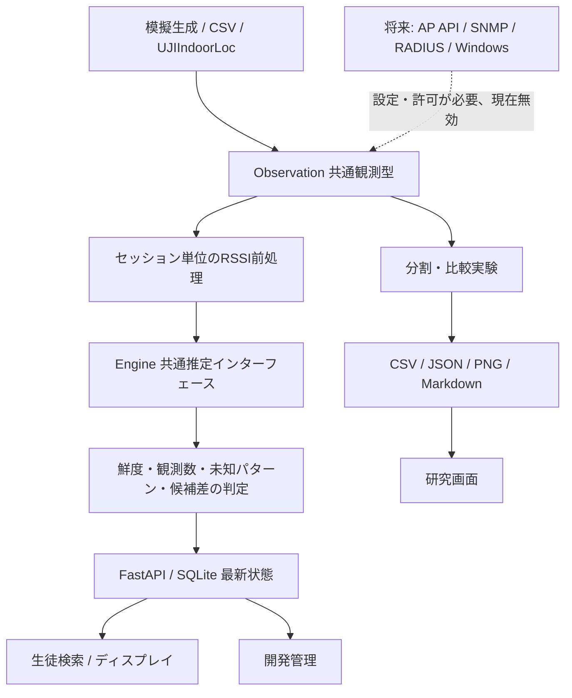

# システム構成と判断記録

## 責務

`models.py`が観測と推定結果、`sources.py`が入力、`simulation.py`が模擬環境、`filters.py`が時系列前処理、`selection.py`がAP選択、`algorithms.py`が分類と信頼性判定を担当する。`experiments.py`がデータ分割・パラメータ比較・評価を実行し、Web APIは推定器を呼び出して最新状態を返す。フロントエンドに分類ロジックを複製しない。

フロントエンドは`App.tsx`（メニュー・画面切替・一覧の定期取得）、`views/`（画面ごと）、`lib/`（検索の正規化・鮮度判定・時刻表示などの小さな関数）、`components/`（グラフ・アイコン）に分ける。画面側で繰り返すのは、通信が止まっても古いエリアを出し続けないための鮮度判定と、検索語の正規化（バックエンドの`search_key`と同じ規則）だけである。

Web APIは、ルーティングの外側に2つのミドルウェアを置く。外側の`TrustedHostMiddleware`がループバック以外のHostヘッダーを拒否し、内側の`BrowserSafetyMiddleware`が本文サイズの上限とセキュリティヘッダー・キャッシュ指定を付ける。詳細は[情報管理とプライバシー](SECURITY.md)。

`Observation`はタイムゾーン付き日時、AP→RSSI辞書、仮名端末ID、測定セッションID、任意の正解エリア、接続AP、収集方式を持つ。`Estimate`はエリア（または`unknown`）、理由、候補スコア、距離を持つ。スコアは候補間の相対的な支持であり、正解確率ではない。

## データの境界

1. 収集層が生の情報を共通観測型へ変換する。RSSIなしの接続AP情報と、複数APのRSSIを区別する。
2. 学習用の指紋は場所が既知の研究データとして独立保存する。観測ソースの混在は拒否する。
3. フィルタは同じ端末・静止セッション内の過去値だけを利用する。異なるセッション・端末間で状態を引き継がず、その時点で欠測したAPを過去値で見せかけて復活させない。
4. WebのSQLiteは現在の教員表示情報と最新観測・最新結果を扱う。研究用ファイルにある匿名測定系列と、教員の行動履歴を混同しない。
5. 生徒用レスポンスは表示専用の型へ変換する。管理用の端末対応やAP/RSSIをそのままシリアライズしない。非公開では更新日時も隠す。

## 採用理由と代替案

| 判断 | 理由 | 代替案と採用条件 |
|---|---|---|
| まず説明可能な基準手法を比較 | 4AP・6エリアの研究で複雑さの効果を測れる | ニューラルネット等は独立テストで改善が示せた場合 |
| 線形一次元カルマン | 静止PCのRSSIノイズ低減という状態モデルで足りる | 非線形の明確なモデルが必要ならEKF/UKFを再検討 |
| メーカー非依存の観測型 | 実機収集方式が未確定 | メーカーAPIの詳細はアダプター内に閉じ込める |
| SQLiteとローカル実行 | 個人PCで理解・再現しやすい | 同時利用・可用性要件が確定後にDB/運用方式を選ぶ |
| 未知判定を表示前に実施 | 誤ったエリアを断定表示しにくくする | しきい値は検証データで誤表示と不明率を比較して選ぶ |
| 最新状態のみ | 軌跡を扱う目的がない | 行動履歴機能は本プロジェクトの範囲外 |

FastAPIの起動時資源管理には公式で推奨される`lifespan`を使う。テストは`TestClient`と`httpx`を使う。[FastAPI lifespan](https://fastapi.tiangolo.com/advanced/events/)、[FastAPI testing](https://fastapi.tiangolo.com/tutorial/testing/)。

## 制約

同一SSIDでもBSSIDやコントローラー上のAP IDは識別に使えるが、無線帯域・仮想SSID・AP交換による対応変更を管理する必要がある。AP側で測ったPCの上りRSSIと、PC側で測ったAPの下りRSSIの指紋は無検証で共用しない。教員PCを動かさない静止セッションの平滑化が、移動時も正しいことを意味しない。
