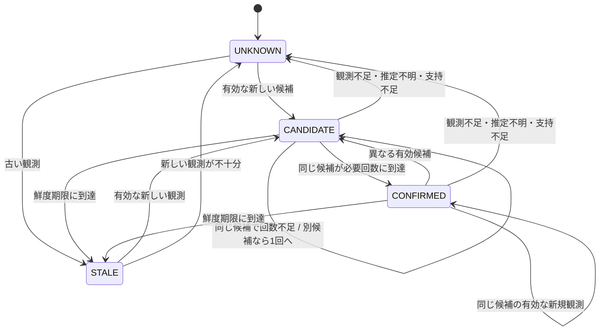

# エリア表示を管理する有限オートマトン

`src/wifi_location/state_machine.py` は、推定器が返した候補について、現在のPC所在エリアとして表示できるかを決める。`Engine` の推定方式はそのまま使い、状態管理をAPIの表示直前に加える。実装は `main` に統合済みで、既定では無効。環境変数 `WIFI_FSM_ENABLED=1` で有効にする。この文書は実装の状態・入力条件・運用上の制約を説明する。模擬データでの評価条件と数値は[実験手順](FSM_EXPERIMENTS.md)・[実験結果](FSM_RESULTS.md)を参照する。

## 状態と外部表示

|内部状態|保持する証拠|生徒向けAPI|
|---|---|---|
|`UNKNOWN`|確認に使える候補なし|`status=unknown`, `area=null`|
|`CANDIDATE`|候補エリアと連続確認回数|`status=unknown`, `area=null`|
|`CONFIRMED`|必要回数を満たした候補|`status=located` と表示用エリア名|
|`STALE`|最後の観測時刻。候補と回数は消去|`status=unknown`, `area=null`, `reason=stale`|

公開中の観測には、候補段階や期限切れでも最新測定時刻を付ける。非公開では、内部状態に優先して `status=private` とし、場所・時刻・理由を隠す。候補名と内部状態を生徒向けレスポンスへ追加しない。認証済み管理APIにだけ `fsm.phase`、`confirmations`、`required_confirmations` を付ける。

次は必要確認回数が2以上の場合の主要な遷移である。1回に設定した場合、有効な新しい候補から直接 `CONFIRMED` になる。



## 入力イベントと優先順位

|入力・条件|処理|
|---|---|
|非公開への変更|DBの最新観測とメモリ内FSM証拠を消し、その応答から非公開表示|
|同じ測定のGET|鮮度だけ確認。確認回数を増やさない|
|最終観測から180秒以上|候補と回数を消し `STALE`。次の観測から確認をやり直す|
|時刻が進んだ有効な観測|同じ候補なら回数を1つ加え、別候補なら1回から始める|
|候補が変化|以前のエリアを隠し、新しい候補を必要回数まで確認|
|既知AP数不足・未知判定・スコア不正・支持不足|候補と回数を消し `UNKNOWN`|
|同一時刻・逆順のPOST|FSM有効時は409。最新観測と確認回数を維持|
|5秒を超える未来時刻|POSTは422。現在時刻が巻き戻り保存済み観測が未来になった場合も表示を隠す|
|不正RSSIなどの入力形式エラー|POSTは422。保存と状態更新を行わない。以前の有効な観測は鮮度期限まで有効|
|推定方式・AP対応表の変更|確認証拠を消し、変更後の新しい観測を待つ。同じ設定の再保存では消さない|
|再起動|確認証拠を初期化。DBに新鮮な観測があっても確定済みとして復元しない|

純粋関数 `observe(state, estimate, observed_at, now, observed_aps, config)` と `expire(state, now, config)` は、新しい `FsmState` を返す。時刻の比較ではタイムゾーンを含める。同じ瞬間を別のタイムゾーンで送っても別観測にはならない。

確認に使うスコアは、有限な0〜1の値で合計1になり、候補が単独で最大であることを確認する。さらに1位と2位の支持の差に下限を設けられる。スコアはモデル内の相対支持であり、正解確率ではない。既存Engineの未知判定も先に適用する。

AP数には学習指紋または対応表で既知のAPだけを数える。`connected_ap` 方式では既知の接続APも1台の観測として数え、同じAPのRSSIと二重に数えない。接続AP1台しか得られない入力は、既定の最低2台では確定しない。

## 非公開を独立したフラグにした理由

`PRIVATE` をFSMへ含める方法では、公開へ戻したときの遷移と、推定器が返す品質状態が同じ状態表に混在する。そのため既存のDBの `teachers.private` を表示の最優先条件にし、FSMの前後で必ず参照する。これにより、状態遷移の追加が非公開の優先度を下げない。公開へ戻しても削除した観測や確認回数を復元せず、新しい観測から始める。

非公開・観測投入・設定変更は同じStoreロック内で処理する。SQLiteへの書き込みが成功してから、メモリのFSM証拠を公開する。模擬データの一括更新もDBコミット後にまとめて反映し、途中失敗では以前の状態を使う。

## 保存範囲と再起動

DBの構造は追加しない。既存の `latest` テーブルに、対象ごとに最新観測1件だけを保存する。FSMは対象ごとに現在の状態、候補、確認回数、最新観測時刻、理由をメモリ内に置き、対応する推定器との一致も確かめる。履歴や軌跡を蓄積しない。

再起動後は `UNKNOWN` から始め、保存済み観測の時刻を重複判定に使う。保存済み観測のGETや同時刻の再送では確定しない。削除・非公開・保持期限による観測削除に合わせ、対応するメモリ上の証拠も消す。

同じSQLiteへ別接続から書き込みがあった場合は `PRAGMA data_version` で検知し、ローカルの確認証拠を全て破棄する。時刻を使い回した外部更新でも、以前の確定状態を流用しない。この動作は複数ワーカーへの確認回数の共有を実現するものではないため、FSM有効時はAPIを単一ワーカーで起動する。複数ワーカー・複数サーバー構成は未検証である。

## 有効化と比較

Vivobookのsystemdサービスでは、[サーバー設置ガイドのFSM切替手順](SERVER.md#fsmを有効にして表示を比較する)に従い、`/etc/wifi-location/wifi-location.env` を編集してサービスを再起動する。シェルで環境変数を設定するだけでは、既に動いているsystemdサービスの設定は変わらない。

開発環境では、[README](../README.md)のセットアップを済ませたプロジェクトのルートで次を実行する。既に8000番で起動中の開発サーバーがあれば、先にそのターミナルでCtrl+Cを押して止める。環境変数は起動時に読み込む。

```bash
npm --prefix frontend run build
WIFI_FSM_ENABLED=1 WIFI_FSM_CONFIRMATIONS=3 \
  .venv/bin/python -m uvicorn wifi_location.api:app --app-dir src --host 127.0.0.1 --port 8000 --workers 1
```

[画面](http://127.0.0.1:8000/)を開き、[設定API](http://127.0.0.1:8000/api/config)の `fsm.enabled` が `true`、`confirmations` が `3` になっていることを確認する。管理画面へは、起動時に表示される管理トークン（固定トークンを設定済みならその値）で接続する。

既存方式の表示と比べるときはCtrl+Cで停止し、上の `WIFI_FSM_ENABLED=1` を `WIFI_FSM_ENABLED=0` に変えて起動し直す。設定APIの `fsm.enabled` が `false` であることを確認する。同じDBの最新観測を使うが、再起動でFSMの確認証拠は消える。再有効化後は新しい観測を投入して比較する。条件を揃えた定量比較には[再現用の実験手順](FSM_EXPERIMENTS.md)を使う。

|環境変数|既定値|意味|
|---|---:|---|
|`WIFI_FSM_ENABLED`|`0`|`1` でFSMを使用|
|`WIFI_FSM_CONFIRMATIONS`|`3`|必要な連続確認回数。1以上の整数|
|`WIFI_FSM_MIN_APS`|`2`|必要な既知AP数。1以上の整数|
|`WIFI_FSM_MIN_MARGIN`|`0`|FSMが追加で要求する支持差。0〜1|

Webの鮮度期限は既存のAPIと画面に合わせて180秒に固定する。純粋モジュールの `FsmConfig.max_age_seconds` は独立実験では変更できる。`GET /api/config` の `fsm` フィールドで起動中の設定を確認できる。管理画面でも確認回数と候補の確認状況を表示する。

既定の3回は暫定値であり、最適と確認した値ではない。3秒間隔で毎回有効な同じ候補が出る理想条件では、1回目から確定まで最短6秒かかる。模擬調整用データで選ばれた2回は実験用の設定であり、Webの既定値とは異なる。必要回数を増やすと誤表示を減らせる場合がある一方、位置不明と待ち時間が増える。[比較条件](FSM_EXPERIMENTS.md)・[実行結果](FSM_RESULTS.md)

## デモと検証範囲

FSM有効時の「模擬データを更新」は、押すたびに新しい乱数サンプルから観測を生成する。数秒間隔で複数回押し、管理画面の「確認中」と表示の変化を確かめる。生徒画面の更新はGETだけで、確認回数を増やさない。同一時刻でのデモ更新はスキップする。ノイズやAP欠損も生成するため、必ず指定回数のボタン操作で確定するとは限らない。

新しい測定かどうかは観測時刻が進んだことで判定する。同じRSSI値は静止測定でも生じるため、値の一致だけで再送とは扱わない。将来の実機収集では、コントローラーのキャッシュ値に取得時刻を付け直すだけで新しい観測とみなさないよう、機器側の観測時刻・更新周期を確認する必要がある。

単体テストは各状態・TTL境界・候補変更・スコア不正・時刻巻き戻りを扱う。APIテストはGET、重複・逆順POST、非公開、既存方式、再起動、外部DB更新、設定変更、模擬更新、バッチ失敗を扱う。学校APとの収集連携や実機の観測周期は検証対象に含めていない。
