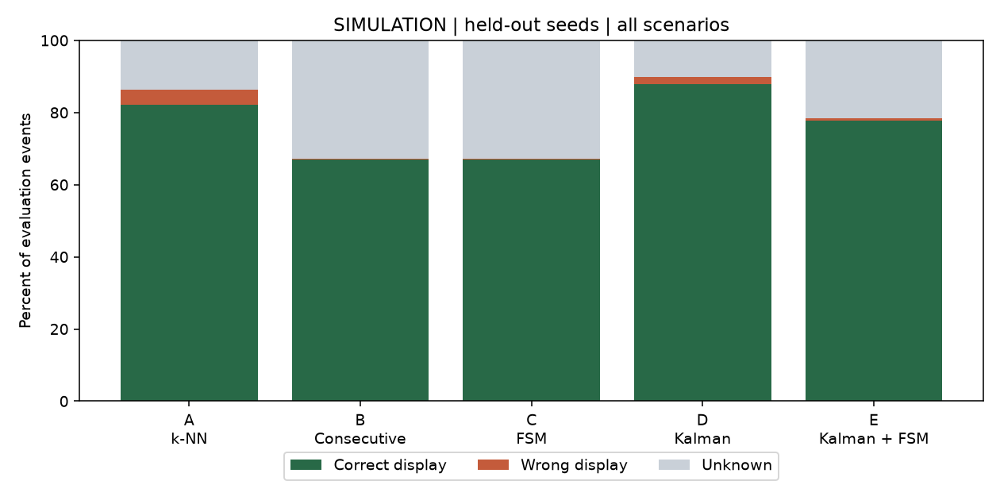
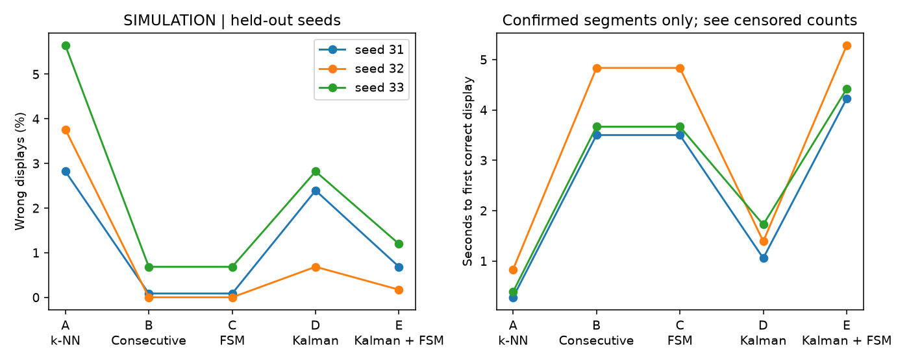

# FSMの実行結果と判断

2026年11月7日に実行。全データは模擬生成し、学校のPC・AP・教員情報を使用していない。実行方法・分割・分母は [実験条件](FSM_EXPERIMENTS.md)、全数値は [実行レポート](../results/fsm/REPORT.md) に記録した。

## 固定した条件

学習用シード11〜13、調整用21〜23、最終評価用31〜33。調整用だけで選んだ値は、新しい観測で同じ候補を2回、既知AP最低2台、モデルスコア差0.25以上。最終評価は1方式あたり3,510イベント、5方式で17,550イベント、各方式162の開始・エリア変更区間である。時刻確認・再送のイベントも分母に含める。

## 全体の結果

|方式|正解表示率|誤表示率|位置不明率|初回正解表示までの平均観測数|平均秒数|最後まで正解表示に到達しなかった区間|
|---|---:|---:|---:|---:|---:|---:|
|A 既存k-NN|82.3%|4.1%|13.7%|1.17|0.50|0/162|
|B 単純な連続判定|67.0%|0.3%|32.8%|2.33|4.00|0/162|
|C FSM|67.0%|0.3%|32.8%|2.33|4.00|0/162|
|D カルマン＋既存k-NN|88.0%|2.0%|10.1%|1.46|1.39|0/162|
|E カルマン＋FSM|77.7%|0.7%|21.6%|2.55|4.64|1/162|

平均待ち時間は正解表示に到達した区間だけの値。観測間隔は3秒。表示の丸めで3比率の合計が100%から0.1ポイントずれる場合がある。

CはAより誤表示を減らした一方、位置不明と待ち時間が増えた。BとCは全予測が一致した。今回選んだFSMの追加条件は既存Engineと同じスコア差・AP数で、Bにも同じ鮮度・再送対策があるためである。この結果からFSMの名称や状態数自体による精度向上は主張しない。FSMでは、候補・確定・期限切れ・非公開を扱う条件を明示し、APIの表示と検証を一貫させた。

## 安全性を分けて見る

- **一時的な誤指紋**を18回注入した。そのイベントで誤エリアを表示した回数はAが17回、B/Cが0回、Dが5回、Eが0回。
- **期限切れ表示**は全方式で0回。既存Engineにも鮮度判定があり、Aの機能でも防げる。
- **エリア変更を含む試行**の誤表示率はA 4.40%、B/C 0.23%、D 7.87%、E 4.86%。カルマンの過去値が残ると、エリアが実際に変わった後も前のエリアを支持し得る。FSMも、入力された候補が変わるまで真の変化を知ることはできない。
- **エリア変更後だけの待ち時間**はA 1.00秒、B/C 5.00秒、D 8.83秒、E 11.82秒。Eは18区間中1区間で最後まで正解表示に到達せず、平均は残り17区間の値。
- **AP欠損**では、現在の観測が最低AP数を満たさなければ全方式が場所を表示しない。過去の受信値で欠測を補う処理は加えていない。
- **再送・逆順観測**は受信時に除外した。同じ観測をGETしても回数が増えないこと、非公開の優先、再起動後の初期化は別途API・単体テストで検証する。

シード別・シナリオ別の分母、表示変動回数、エリア変更後だけの待ち時間、未確定区間は [metrics.csv](../results/fsm/metrics.csv) と [by_seed.csv](../results/fsm/by_seed.csv) に保存した。全予測は [predictions.csv](../results/fsm/predictions.csv) で照合できる。

## 採用と限界

FSMは既定で無効にし、環境変数で既存方式と切り替える。Webの暫定確認回数は3回で変更可能。今回の調整用評価では2回が選ばれたが、この模擬モデルの条件だけで学校向け設定を確定しない。既定3回を最適と主張するものでもない。[設定と設計判断](FSM_DESIGN.md)

カルマンとFSMを組み合わせれば必ず安全になるという結果ではなかった。静止場面での利点と実際のエリア変更での遅れを分け、今回のWebにはカルマンの時系列状態を追加していない。

独立した乱数でも全データは同じ電波生成モデルに依存する。今回のシード数は3で、統計的な優越や実校内の精度を示すには足りない。実機の観測更新周期、古い値のキャッシュ、Cisco管理方式、Windowsでの取得、複数サーバーでの運用は未検証。今後パラメータを変更したら、調整に使用した集合と新しい評価集合を明記する。
