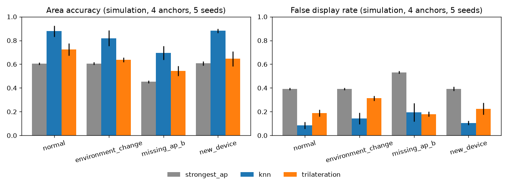
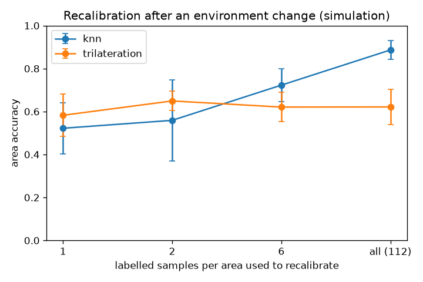

# GPSのように無線で距離を測って位置を出す案の検討

対象の案：教員PCどうし、あるいは位置の分かっている3〜4台の機器との無線通信から距離を求め、GPSのように位置を出す。iPhoneの「探す」に近いのではないか。

結論を先に書く。

- 「位置の分かっている機器（アンカー）が発信し、PCは受信だけする」形にすれば、PCどうしの通信は要らず、プライバシー面も安全側に寄せられる。
- ただし距離をRSSI（電波の強さ）から出す限り、環境依存の問題は指紋方式と同じく残る。今回のシミュレーションでは、指紋方式（k-NN）より正解率が低く、誤表示率が高かった。
- GPSに近い精度を狙うなら、到達時間で測るFTM（Wi-Fi）かUWBが必要になる。学校のAPと教員PCが対応しているかは未確認。
- 「探す」は三辺測位ではなく、仕組みが違う。

数値はすべて模擬データの結果で、学校の実環境での性能を示すものではない。

## GPSが正確に位置を出せる理由

- 衛星の位置が正確に分かっている。
- 衛星は原子時計の時刻を載せた電波を出し、受信機は**到達時間**から距離を出す。3次元の位置に受信機の時計のずれを加えた4つの未知数を解くため、普通は4機以上の衛星を使う。
- 受信機は聞くだけで、何も発信しない。だから何台使っても衛星側の負担は増えず、受信機の位置も衛星側に知られない。

屋外の見通しのよい空では、到達時間と距離の関係が安定している。屋内ではこの前提が崩れる。

## 屋内でRSSIから距離を出す場合

RSSIは距離が遠いほど下がる（距離減衰モデル `RSSI = p0 − 10·n·log10(距離)`）。しかし実際には次の影響を強く受ける。

- 壁・床・棚による減衰
- 反射（マルチパス）
- 人の体
- 端末ごとのアンテナ差

RSSIの揺れが数dBあると、距離の推定は数十%ずれる。今回の模擬データでは、測定ノイズ3.5 dB、減衰係数 n≈2.4 なので、1回の測定で距離が約±40%ずれる（10 mなら±4 m程度）。教室の階の間隔（模擬では4 m）より大きい。

つまり、RSSIで三辺測位をしても「環境依存が強すぎる」という指摘はそのまま当てはまる。指紋方式は、その環境依存を測定データとして丸ごと覚える方式なので、測った時点の環境では強い。

## 到達時間で距離を測る方法

| 方法 | 内容 | この学校で使うための条件 |
|---|---|---|
| Wi-Fi FTM（IEEE 802.11mc/az） | APとの往復時間から距離を出す | AP側がFTMに応答できること。PC側のWi-Fiチップ・ドライバ・ソフトが対応していること |
| UWB | 広い帯域の電波で到達時間を細かく測る | PCとアンカーの両方にUWBが必要。一般的な業務用Windows PCに載っているとは限らない |
| BLE（RSSI） | ビーコンの電波強度 | 距離はRSSIなので環境依存は同じ。アンカーの電池交換が保守として増える |

参考にした公開情報：

- Androidの実装ガイドでは、802.11mcの距離誤差の目標（90パーセンタイル）を80 MHz幅で2 m、20 MHz幅で8 mとしている。802.11azではさらに小さい目標値がある。いずれも目標値で、実環境では校正試験が要るとしている。[Android Wi-Fi RTT](https://source.android.com/docs/core/connect/wifi-rtt)
- Windowsにはドライバ側のFTM要求の仕組みがある（[OID_WDI_TASK_REQUEST_FTM](https://learn.microsoft.com/en-us/windows-hardware/drivers/netcx/oid-wdi-task-request-ftm)）。アプリから一般に使えるか、教員PCのWi-Fiアダプターが対応しているかは**未確認**。
- 学校のAP（AIR-AP1832I-Q-K9C）がFTMに応答できるかは**未確認**。

階の区別には、距離誤差が階の間隔より十分小さい必要がある。FTMの目標値でも2 m前後の誤差があるため、階の判定ではFTMでも確実とは言えない。

## iPhoneの「探す」との違い

「探す」は三辺測位ではない。

- なくした端末がBluetoothで信号（定期的に変わる公開鍵）を出す。
- 近くを通った他人のApple製品がそれを受信し、**自分のGPS位置**を、その鍵で暗号化してAppleへ送る。
- 持ち主だけが復号できる。Appleにも、見つけた人が誰かにも、位置は分からない。
- 近距離で探すときは、対応機種ならUWBで方向と距離を出す。

出典：[Apple Platform Security「探す」](https://support.apple.com/guide/security/sec6cbc80fd0/web)

この方式が成り立つのは、見つける側の端末が位置を知っている（GPSがある）からである。学校の教員PCにはGPSがなく、屋内でもあるため、そのままは使えない。似ている点は「通りがかりの機器が受信だけして、結果を暗号化して送る」という通信の形だけである。

## 端末どうしの通信を増やさない形

| 形 | 誰が発信するか | PCどうしの通信 | 安全面 | 保守 |
|---|---|---|---|---|
| A. PCどうしで距離を測る（協調測位） | 全PC | 必要 | PCが常に発信するので第三者に追跡されうる | 絶対位置を決めるため、結局位置の分かる機器が要る |
| B. 固定アンカーが発信し、PCは受信だけ（GPS型） | アンカーのみ | 不要 | PCは発信しない。サーバーへの送信は測定結果1件だけ | アンカーの設置・位置管理・電源（電池） |
| C. 既存APをアンカーにする（現行の構成に近い） | AP | 不要 | Bと同じ | 新しい機器は不要。APの位置を記録する |

Aは避けたほうがよい。PCが発信を続けると、誰でも近くで受信して「その先生のPCがここにある」と分かってしまう。「探す」が鍵を頻繁に変えているのはこの追跡を防ぐためである。

BとCは、PCが受信して結果をサーバーに送る点で、PCにソフトが必要になる。これは「教員PCに専用ソフトを入れない」方針と両立しない。学校が許可するかを確認する必要がある（[学校への確認事項](SCHOOL_QUESTIONS.md)）。

## シミュレーションでの比較

実装：

- 三辺測位：[`trilateration.py`](../src/wifi_location/trilateration.py)
- 実験：[`trilateration_experiments.py`](../src/wifi_location/trilateration_experiments.py)
- 結果：[`results/trilateration/REPORT.md`](../results/trilateration/REPORT.md)

```bash
.venv/bin/python -m wifi_location.trilateration_experiments --output results/trilateration
```

方法：

- 既存の模擬環境（4 AP・3階・各階2エリア）を使う。APの位置をアンカーの位置とみなす。
- 三辺測位では、学習データから距離減衰の係数 p0・n を推定する。RSSIから各アンカーまでの距離を出し、その距離に最も合う位置を格子上で探して、最も近いエリアを答える。
- 距離の食い違い（残差）が大きいとき、または2つのエリアの差が小さいときは「不明」とする。
- 閾値は検証データで「正解率−2×誤表示率」が最大になるように選び、テストデータで評価した。
- 比較対象：
  - k-NN指紋（既存方式。kも検証データで選ぶ）
  - 最強AP（いちばん強いAPのエリアを答える）
- シードは42〜46の5つで、表の値は平均（±は標準偏差）。
- 同じコマンドを2回実行し、CSVが完全に一致することを確認した。

条件：

- 通常
- 環境変化：学習後に、AP_Bの前に棚が置かれて−8 dB、間仕切りの減衰が4→8 dBに変わった
- AP_B欠損：AP_Bが受信できない
- 別端末：学習にない端末で評価
- 環境変化後の作り直し：変化後に、少ない測定で作り直す（保守の代理指標）

### アンカー4台、学習データをすべて使った場合

|条件|方式|正解率|誤表示率|不明率|
|---|---|---:|---:|---:|
|通常|最強AP|0.605|0.392|0.003|
|通常|k-NN|**0.878**|**0.085**|0.036|
|通常|三辺測位|0.725|0.190|0.085|
|環境変化|k-NN|**0.819**|**0.144**|0.037|
|環境変化|三辺測位|0.638|0.313|0.049|
|AP_B欠損|k-NN|**0.696**|0.194|0.110|
|AP_B欠損|三辺測位|0.544|**0.179**|0.277|
|別端末|k-NN|**0.882**|**0.105**|0.013|
|別端末|三辺測位|0.645|0.224|0.130|

アンカー3台（AP_A・B・C）では次のようになった。

- 通常時：三辺測位 0.517、k-NN 0.799。
- AP_Bが欠けると、三辺測位はアンカーが2台になり、すべて「不明」になった。2台では平面上の位置が決まらないためで、設計どおりの動作である。

### 環境変化の後、少ない測定で作り直した場合（アンカー4台）

|1エリアあたりの測定数|k-NN 正解率|k-NN 誤表示率|三辺測位 正解率|三辺測位 誤表示率|
|---:|---:|---:|---:|---:|
|1|0.522±0.120|0.258|0.583±0.098|0.180|
|2|0.559±0.189|0.146|0.649±0.045|0.226|
|6|0.723±0.078|0.135|0.621±0.068|0.197|
|すべて（約112）|0.887±0.044|0.082|0.622±0.081|0.215|




### 読み取れること

1. **通常時は指紋方式が上。** 三辺測位は正解率が約15ポイント低く、誤表示率が約2倍だった。
2. **環境変化に強いという仮説は、この模擬では支持されなかった。** 環境変化による正解率の低下は次のとおりで、三辺測位のほうが落ち方が大きかった。誤表示率も0.19→0.31と大きく増えた。
   - k-NN：0.878→0.819
   - 三辺測位：0.725→0.638
   - 距離減衰モデルの係数が、棚や間仕切りの変化をそのまま距離の誤りとして受け取るためである。
3. **誤りのほとんどは階の取り違えだった。** 通常条件・5シードで集計すると、三辺測位の誤り273件のうち267件は「同じ側の別の階」だった。RSSIから出した距離の誤差（数m）が階の間隔（4 m）より大きいことと合っている。
4. **作り直しの測定が1〜2件/エリアしかないときは、三辺測位の正解率が同等か少し高い。** 係数が2つ（p0・n）だけなので、少ないデータでも推定できるためである。ただし次の点に注意が要る。
   - 誤表示率は三辺測位のほうが高い場合がある。
   - 5シードの標準偏差の範囲内の差で、確かな差とは言えない。
   - 6件/エリア以上では、k-NNが上回った。
5. この模擬環境は、そもそも距離減衰モデルで電波を作っている。三辺測位に有利な条件である。反射が多い実際の建物では、差がさらに広がる可能性がある。

まとめると、RSSIで三辺測位に替えても、精度・環境変化への強さ・誤表示のいずれも改善しなかった。保守の面では「少ない再測定で一応動く」という利点の可能性が残るが、これは未確定である。

## 保守コストと安全面の比較

数値で比べにくい項目は、何が必要になるかを並べて比べる。

| 観点 | 指紋（現行） | RSSI三辺測位（既存AP） | FTM/UWBアンカー |
|---|---|---|---|
| 追加の機器 | なし | なし | 対応AP、またはアンカー機器 |
| PC側のソフト | 管理側の情報で足りれば不要 | 受信して送るソフトが必要 | 対応ドライバとソフトが必要 |
| 初回の測定 | 各エリアで多数 | アンカー位置の記録＋少数の測定 | アンカー位置の記録＋校正 |
| 環境変化時 | 変化したエリアで測り直す | 係数の再推定（少数）。ただし精度は戻りにくい | 校正の確認（見通しが変わると誤差が出る） |
| 電池・故障 | なし | なし | ビーコン型なら電池交換、故障時の交換 |
| PCが発信するか | しない | しない | しない（形B・C） |

PCどうしで測る形（A）は、PCの発信が必要になる。追跡されうる点と通信量が増える点から、採用しないほうがよい。

## 研究としての位置づけ

アンカーを使った三辺測位、協調測位、FTMによる屋内測位には、すでに多くの研究がある。方式そのものに新規性はない。新規性を出すなら、次のような問いになる。

- 学校の既存設備（同一機種のAP・業務用Windows PC）に、固定アンカーを数台加えた条件で、指紋方式と比べる。
- 比べる観点は、誤表示率、環境変化の後に再測定が何件必要か、アンカーの台数と保守負担の3つ。
- 「誤表示を出さない」ことを優先する評価（不明を許して誤表示を抑える）で比べる。

## 実機で確かめる前に必要なこと

1. 学校のAPがFTMに応答するか、教員PCのWi-Fiアダプターとドライバが FTM を使えるかを確認する。
2. PCに受信用ソフトを入れてよいか、学校の許可を得る（現行方針の「専用ソフトなし」を変えることになる）。
3. 許可されれば、1部屋・アンカー3〜4台・架空または同意済みの端末だけで、FTMの距離誤差を校正手順どおりに測る。
4. 距離誤差が階の間隔より十分小さい場合に限って、エリア推定まで広げる。
