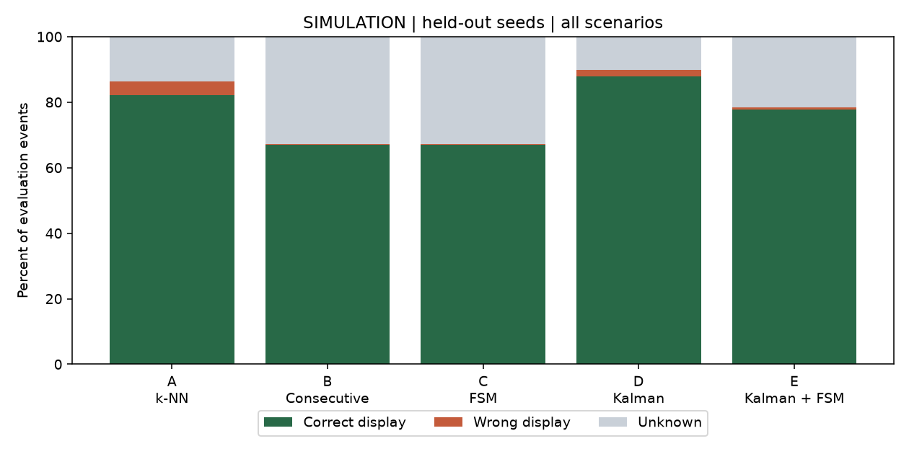
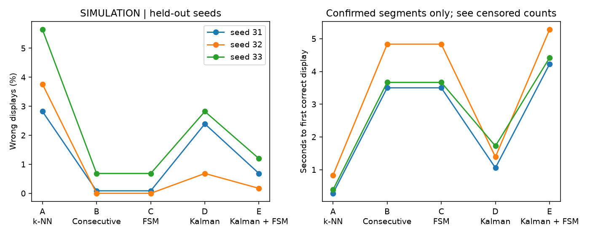

# 表示状態の比較実験結果

全て模擬データ。実在の教員・学校AP・学校ネットワークは使用していない。

学習シード [11, 12, 13]、調整用 [21, 22, 23]、最終評価用 [31, 32, 33]。
調整用で選んだFSM条件は確認 2 回、スコア差 0.25 以上、既知AP 2 台、鮮度 180 秒未満。

|方式|正解表示率|誤表示率|位置不明率|平均観測数|平均待ち秒|未確定区間|表示変動回数|期限切れ表示|
|---|---:|---:|---:|---:|---:|---:|---:|---:|
|A 既存の推定のみ|82.3%|4.1%|13.7%|1.17|0.50|0/162|871|0|
|B 単純な連続判定|67.0%|0.3%|32.8%|2.33|4.00|0/162|814|0|
|C FSM|67.0%|0.3%|32.8%|2.33|4.00|0/162|814|0|
|D カルマン＋既存推定|88.0%|2.0%|10.1%|1.46|1.39|0/162|481|0|
|E カルマン＋FSM|77.7%|0.7%|21.6%|2.55|4.64|1/162|544|0|

正解表示率・誤表示率・位置不明率の分母は評価イベント全件。期限切れを表示した場合は誤表示に数える。表示変動は不明との切替も含み、独立試行の境界は数えない。平均待ち時間・観測数は初めて正解表示に到達した区間のみで算出し、到達しなかった区間数を別記する。

静止試行を中心に、一時的な誤指紋、AP欠損、エリア変更、期限切れ、重複・逆順受信を追加した。異なる設定で使った入力は同じ。FSMを使わない方式も既存Engineの鮮度判定を使うため、期限切れゼロだけではFSMの優位性を示さない。

## グラフと再確認

[方式・条件別CSV](metrics.csv)、[各シードCSV](by_seed.csv)、[調整用CSV](validation.csv)、[全評価イベントCSV](predictions.csv)、[設定とコードハッシュ](summary.json)。

本実験で使うスコア差はモデルの相対支持の差であり、正解確率ではない。少数のシードと共有の模擬電波モデルによる結果であり、実機性能や統計的優越を示すものではない。カルマンのQ/Rは既存研究値を固定し、この評価では最適化していない。Web本体へのカルマン導入は本実験の対象外。
