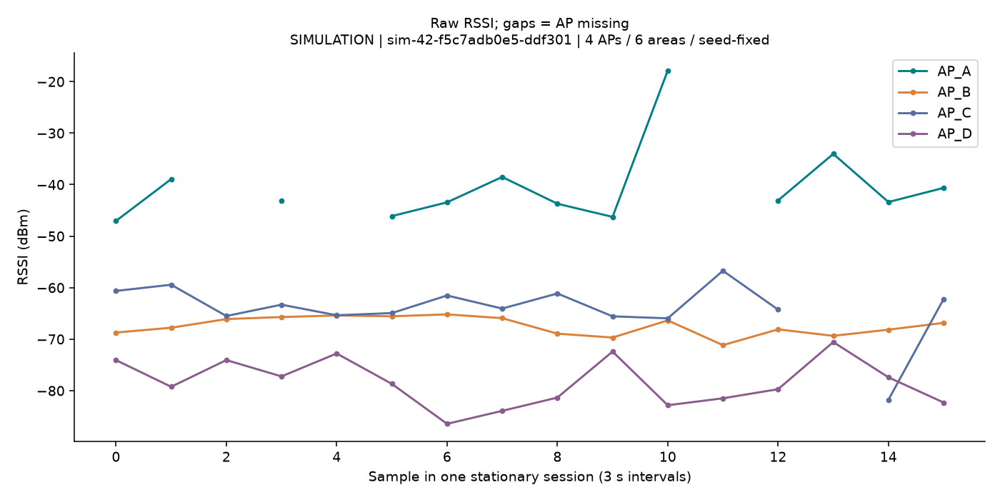
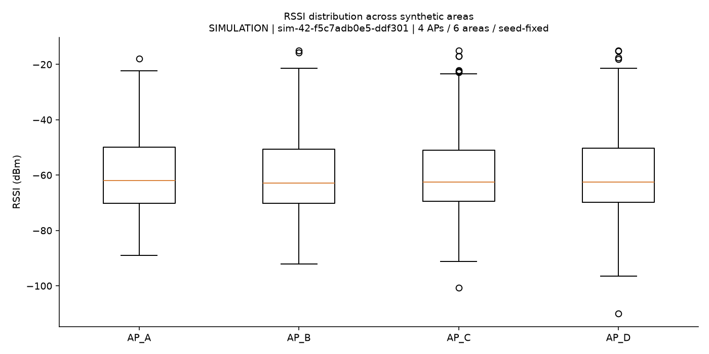
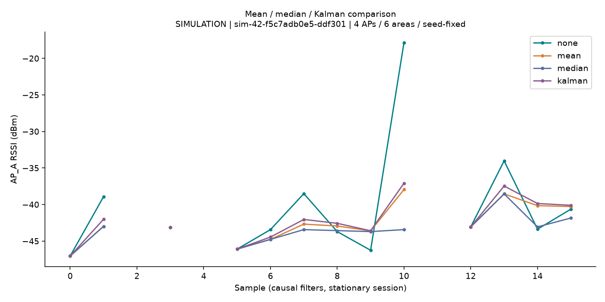
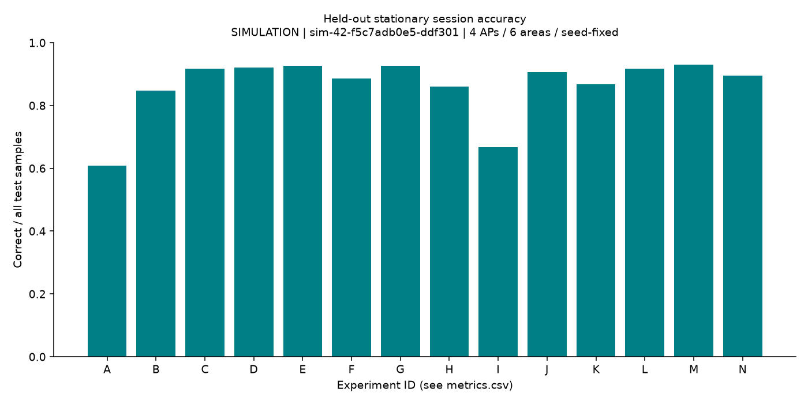
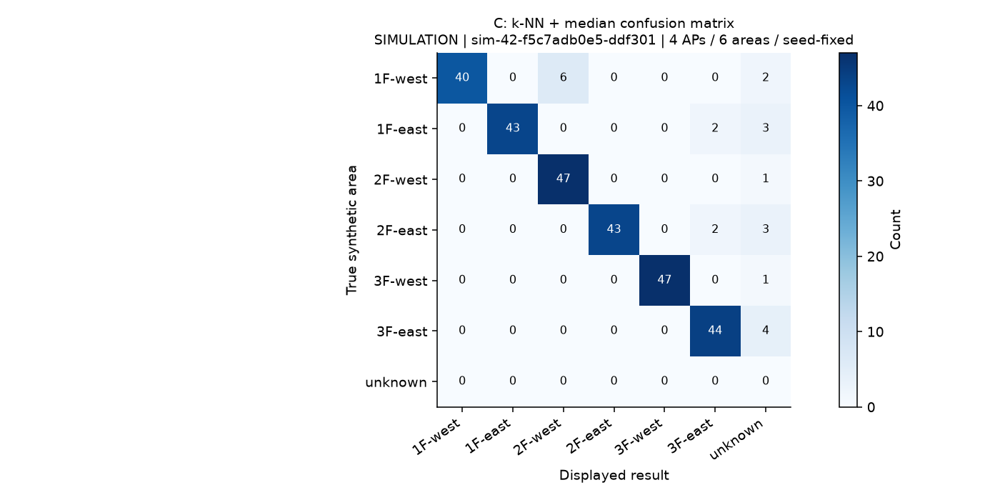
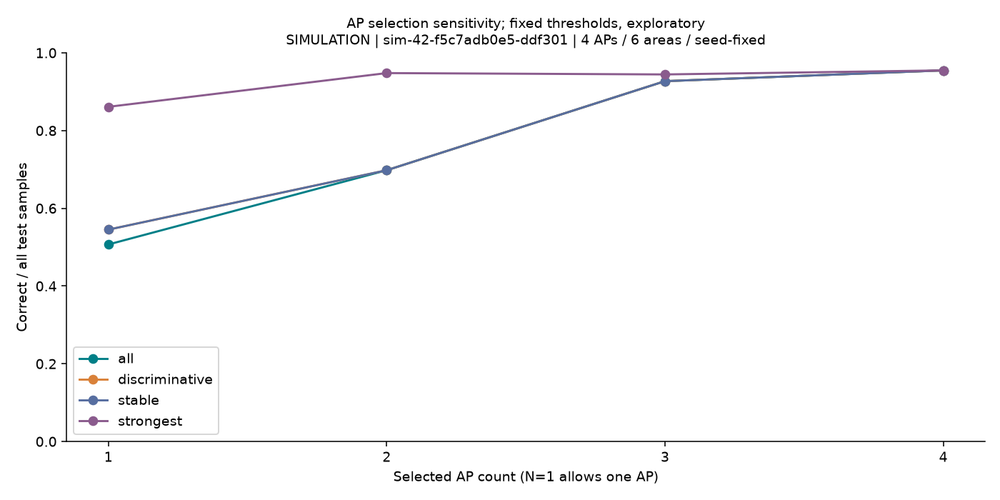
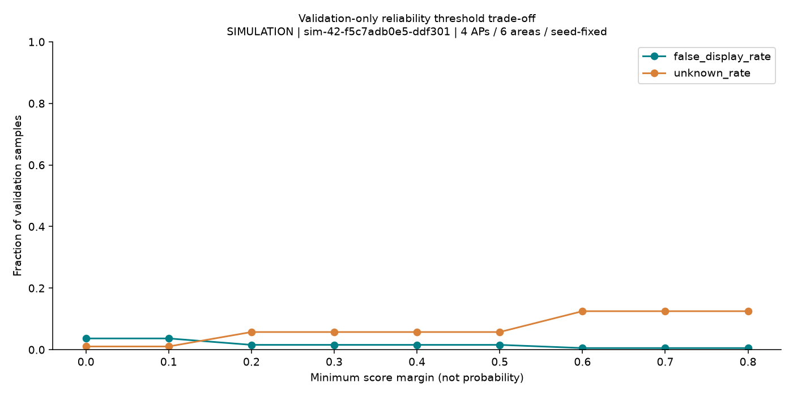

# 模擬データ比較実験レポート

実験ID: `sim-42-f5c7adb0e5-ddf301`。データソース: **simulation**。学校の実測結果ではない。

## 目的・仮説

RSSI前処理と単純な分類器の効果を、セッションを分離して比較する。中央値などが外れ値の影響を減らすと仮定するが、常に改善するとは仮定しない。

## データ・条件

4 AP・6エリア、1152観測。学習/検証/テスト=[672, 192, 288]。固定シード=42。
壁・階による減衰、ノイズ、外れ値、8%のAP欠損、端末オフセット、日付/セッション変動を含む独自の模擬モデル。同じ減衰式で生成した学習・テストの結果は実環境の精度を予測しない。
同じ静止測定バッチの全エリアを同一集合に入れた。フィルタは端末・セッションごとにリセットし、過去と現在だけを使う。検証集合だけで閾値を選択し、テスト集合で比較を行った。
平均/中央値/頑健平均の窓5、EMA alpha=0.35、Kalman Q=1,R=16,初期分散25。kは表を参照。距離は欠損を-100 dBmにしたRSSIのRMS。最小共通AP数2。Gは学習集合のエリア間/エリア内分散比で3 APを選択。

## 指標の定義

正解率=正しく表示した数/N、誤表示率=誤った既知エリアの表示数/N、位置不明率=unknown数/N。表示正答率=正しく表示した数/表示した数（表示0なら未定義）。このテスト集合は既知エリアのみ。スコアは較正確率ではない。推定時間はこのPCでのモデル構築を除く平均時間。

## 定量結果

|ID|方式|前処理|k|正解率|誤表示率|不明率|表示正答率|ms/件|距離閾値|差閾値|
|---|---|---|---:|---:|---:|---:|---:|---:|---:|---:|
|A|strongest_ap|none|5|0.608|0.392|0.000|0.608|0.001|16.0|0.25|
|B|knn|none|5|0.847|0.052|0.101|0.942|0.039|16.0|0.25|
|C|knn|median|5|0.917|0.035|0.049|0.964|0.036|16.0|0.25|
|D|knn|ema|5|0.920|0.028|0.052|0.971|0.035|16.0|0.25|
|E|knn|kalman|5|0.927|0.028|0.045|0.971|0.036|16.0|0.25|
|F|rank|none|5|0.885|0.115|0.000|0.885|1.680|16.0|0.0|
|G|knn|median|5|0.927|0.049|0.024|0.950|0.032|16.0|0.1|
|H|gaussian|median|5|0.861|0.097|0.042|0.899|0.028|16.0|0.1|
|I|connected_ap|none|5|0.667|0.333|0.000|0.667|0.001|16.0|0.25|
|J|1nn|none|1|0.906|0.094|0.000|0.906|0.043|16.0|0.25|
|K|weighted_knn|none|5|0.868|0.049|0.083|0.947|0.036|16.0|0.25|
|L|knn|mean|5|0.917|0.028|0.056|0.971|0.035|16.0|0.25|
|M|knn|robust_mean|5|0.931|0.028|0.042|0.971|0.035|16.0|0.25|
|N|knn|none|3|0.896|0.101|0.003|0.899|0.036|16.0|0.25|

## 端末・日時の分離

固定構成Cを、それぞれ独立した端末/日付分割で再学習・検証した。各評価内でテストデータを閾値選択に使っていない。
- device: 正解率 0.885、誤表示率 0.094、不明率 0.021。分割数 [384, 384, 384]。
- date: 正解率 0.955、誤表示率 0.042、不明率 0.003。分割数 [576, 288, 288]。

## RSSI変動・AP欠損

以下の標準偏差は最初の静止セッションでのAP別標準偏差の平均。全エリアを混ぜた変動幅ではない。
- none: 4.739 dBm
- mean: 2.783 dBm
- median: 2.847 dBm
- robust_mean: 2.792 dBm
- ema: 2.977 dBm
- kalman: 2.651 dBm
- APを先頭から0個追加欠損: 正解率 0.917、不明率 0.049
- APを先頭から1個追加欠損: 正解率 0.597、不明率 0.351
- APを先頭から2個追加欠損: 正解率 0.285、不明率 0.372

## 不明判定の確認

- no_readings: `unknown` / `insufficient_data`
- unmapped: `unknown` / `unmapped_ap`
- far_pattern: `unknown` / `unfamiliar_pattern`
- stale: `unknown` / `stale`

## グラフ

## 考察・制約

最強/接続APの4エリアへの対応だけでは中間階の2エリアを表現できない。前処理が良くない結果も含め全方式を掲載した。結果の差には一つのシードと模擬モデルへの依存があり、統計的有意差や学校での性能は主張できない。
順位方式も絶対RSSI距離による未知判定を併用し、同順位の決着に微小なRSSI距離項を使う。確率的分類はAP間独立と正規分布を仮定し、欠損置換の影響を受ける。
接続/最強APは単一対応表の基準手法で候補差・距離閾値は適用されない。1-NNも通常の投票差は1で、距離が完全に同じ異なるラベルの場合だけ特別に不明とする。これらの表の差閾値を較正された信頼度と解釈しない。
未知エリア検出は距離のヒューリスティックであり、既知エリアと類似した未知エリアを保証して検出するものではない。上の4例は健全性確認で、未知分布に対する検出率の評価ではない。
AP数グラフは固定閾値の探索的感度分析で、方式選定には使わない。strongestは観測ごとの強いN AP、stable/discriminativeは学習データだけで選択。all曲線の部分集合はAP名順の比較用である。

## 次の実験

複数シード、別の減衰モデル、未知エリアの独立収集で検証する。学校の許可後、別端末・別日付の静止測定で再較正する。公開AndroidデータとWindows/管理APIデータを混ぜず、取得方式差の影響を別途評価する。

再実行: `python -m wifi_location.experiments --seed 42 --output results/latest`。manifest/summaryと観測ハッシュで条件を照合できる。時間測定値と生成時刻は実行ごとに変動する。
