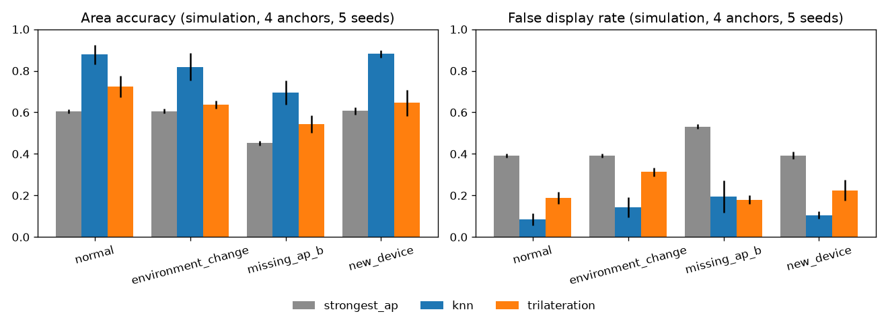

# アンカー三辺測位と指紋方式の比較（シミュレーション）

データは模擬データのみ。学校の実環境での性能を示すものではない。シード 42, 43, 44, 45, 46 の平均±標準偏差。
閾値（k-NN は k も）は検証データで「正解率−2×誤表示率」が最大になるように選び、テストデータで評価した。
正解付きサンプル数の制限（保守の代理指標）は指紋または距離減衰係数の学習に使う数だけを制限し、閾値選択用の検証データは含めない。
all は学習用の全データ（1エリアあたり約 112 件、new_device は 64 件）。strongest_ap は正解付きデータを使わないため、サンプル数によらず同じ値になる。

条件：normal（通常）、environment_change（学習後に AP_B の前に棚を置き −8 dB、間仕切りを 4→8 dB に変更）、
recalibrated_after_change（変更後に測り直したデータで作り直し）、missing_ap_b（AP_B が受信できない）、new_device（学習と別の端末）。

## 学習データをすべて使った場合

|条件|アンカー|正解付きサンプル/エリア|方式|正解率|誤表示率|不明率|
|---|---:|---:|---|---:|---:|---:|
|normal|4|all|strongest_ap|0.605±0.011|0.392±0.010|0.003|
|normal|4|all|knn|0.878±0.047|0.085±0.029|0.036|
|normal|4|all|trilateration|0.725±0.051|0.190±0.029|0.085|
|normal|3|all|strongest_ap|0.453±0.017|0.528±0.018|0.019|
|normal|3|all|knn|0.799±0.072|0.105±0.045|0.097|
|normal|3|all|trilateration|0.517±0.065|0.153±0.052|0.331|
|environment_change|4|all|strongest_ap|0.606±0.011|0.392±0.009|0.003|
|environment_change|4|all|knn|0.819±0.067|0.144±0.049|0.037|
|environment_change|4|all|trilateration|0.638±0.020|0.313±0.022|0.049|
|environment_change|3|all|strongest_ap|0.453±0.017|0.528±0.018|0.019|
|environment_change|3|all|knn|0.684±0.098|0.200±0.097|0.116|
|environment_change|3|all|trilateration|0.458±0.049|0.280±0.025|0.262|
|recalibrated_after_change|4|all|strongest_ap|0.606±0.011|0.392±0.009|0.003|
|recalibrated_after_change|4|all|knn|0.887±0.044|0.082±0.029|0.031|
|recalibrated_after_change|4|all|trilateration|0.622±0.081|0.215±0.060|0.164|
|recalibrated_after_change|3|all|strongest_ap|0.453±0.017|0.528±0.018|0.019|
|recalibrated_after_change|3|all|knn|0.808±0.074|0.101±0.042|0.092|
|recalibrated_after_change|3|all|trilateration|0.422±0.052|0.151±0.033|0.427|
|missing_ap_b|4|all|strongest_ap|0.452±0.011|0.532±0.011|0.016|
|missing_ap_b|4|all|knn|0.696±0.059|0.194±0.078|0.110|
|missing_ap_b|4|all|trilateration|0.544±0.042|0.179±0.021|0.277|
|missing_ap_b|3|all|strongest_ap|0.271±0.025|0.570±0.020|0.159|
|missing_ap_b|3|all|knn|0.535±0.087|0.151±0.059|0.314|
|missing_ap_b|3|all|trilateration|0.000±0.000|0.000±0.000|1.000|
|new_device|4|all|strongest_ap|0.607±0.018|0.393±0.019|0.001|
|new_device|4|all|knn|0.882±0.018|0.105±0.018|0.013|
|new_device|4|all|trilateration|0.645±0.063|0.224±0.050|0.130|
|new_device|3|all|strongest_ap|0.454±0.014|0.533±0.018|0.013|
|new_device|3|all|knn|0.713±0.065|0.142±0.096|0.145|
|new_device|3|all|trilateration|0.463±0.047|0.222±0.035|0.315|

## 環境変化の後、少ない測定で作り直した場合（アンカー4台）

|条件|アンカー|正解付きサンプル/エリア|方式|正解率|誤表示率|不明率|
|---|---:|---:|---|---:|---:|---:|
|recalibrated_after_change|4|1|strongest_ap|0.606±0.011|0.392±0.009|0.003|
|recalibrated_after_change|4|1|knn|0.522±0.120|0.258±0.056|0.220|
|recalibrated_after_change|4|1|trilateration|0.583±0.098|0.180±0.053|0.237|
|recalibrated_after_change|4|2|strongest_ap|0.606±0.011|0.392±0.009|0.003|
|recalibrated_after_change|4|2|knn|0.559±0.189|0.146±0.125|0.295|
|recalibrated_after_change|4|2|trilateration|0.649±0.045|0.226±0.050|0.124|
|recalibrated_after_change|4|6|strongest_ap|0.606±0.011|0.392±0.009|0.003|
|recalibrated_after_change|4|6|knn|0.723±0.078|0.135±0.041|0.142|
|recalibrated_after_change|4|6|trilateration|0.621±0.068|0.197±0.069|0.182|
|recalibrated_after_change|4|all|strongest_ap|0.606±0.011|0.392±0.009|0.003|
|recalibrated_after_change|4|all|knn|0.887±0.044|0.082±0.029|0.031|
|recalibrated_after_change|4|all|trilateration|0.622±0.081|0.215±0.060|0.164|

