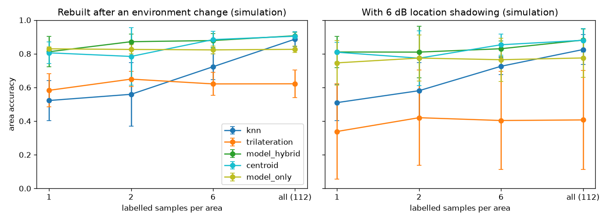

# アンカー三辺測位と指紋方式の比較（シミュレーション）

データは模擬データのみ。学校の実環境での性能を示すものではない。シード 42, 43, 44, 45, 46 の平均±標準偏差。
閾値（k-NN は k も）は検証データで「正解率−2×誤表示率」が最大になるように選び、テストデータで評価した。
正解付きサンプル数の制限（保守の代理指標）は指紋または距離減衰係数の学習に使う数だけを制限し、閾値選択用の検証データは含めない。
all は学習用の全データ（1エリアあたり約 112 件、new_device は 64 件）。strongest_ap は正解付きデータを使わないため、サンプル数によらず同じ値になる。

条件：normal（通常）、environment_change（学習後に AP_B の前に棚を置き −8 dB、間仕切りを 4→8 dB に変更）、
recalibrated_after_change（変更後に測り直したデータで作り直し）、missing_ap_b（AP_B が受信できない）、new_device（学習と別の端末）、
location_shadowing（場所ごとに固定の減衰・増幅を加えた建物。標準偏差 6 dB。距離モデルでは説明できない家具・反射の影響を想定）。

注意：模擬データは距離減衰＋階・間仕切りの減衰で作っているため、同じ形のモデルを使う model_hybrid に有利である。
location_shadowing はこの有利さを減らした条件である。

方式：strongest_ap（最も強いAPのエリア）、knn（指紋 k-NN）、trilateration（RSSIから距離を出す三辺測位）、
model_hybrid（距離と階数から各エリアのRSSIを予測し、測定サンプルで補正した指紋と照合）、
agreement（knn と trilateration が同じエリアを答えたときだけ表示）。
切り分け用：centroid（model_hybrid から予測を除き、測定したエリア平均だけで照合）、
model_only（model_hybrid から補正を除き、距離と階数による予測だけで照合）。

## 学習データをすべて使った場合

|条件|アンカー|正解付きサンプル/エリア|方式|正解率|誤表示率|不明率|
|---|---:|---:|---|---:|---:|---:|
|normal|4|all|strongest_ap|0.605±0.011|0.392±0.010|0.003|
|normal|4|all|knn|0.878±0.047|0.085±0.029|0.036|
|normal|4|all|trilateration|0.725±0.051|0.190±0.029|0.085|
|normal|4|all|model_hybrid|0.907±0.031|0.040±0.018|0.053|
|normal|4|all|agreement|0.672±0.059|0.029±0.013|0.299|
|normal|4|all|centroid|0.902±0.022|0.048±0.026|0.050|
|normal|4|all|model_only|0.905±0.029|0.047±0.030|0.049|
|normal|3|all|strongest_ap|0.453±0.017|0.528±0.018|0.019|
|normal|3|all|knn|0.799±0.072|0.105±0.045|0.097|
|normal|3|all|trilateration|0.517±0.065|0.153±0.052|0.331|
|normal|3|all|model_hybrid|0.805±0.056|0.110±0.034|0.085|
|normal|3|all|agreement|0.469±0.057|0.022±0.011|0.510|
|normal|3|all|centroid|0.804±0.057|0.110±0.034|0.085|
|normal|3|all|model_only|0.794±0.050|0.105±0.026|0.101|
|environment_change|4|all|strongest_ap|0.606±0.011|0.392±0.009|0.003|
|environment_change|4|all|knn|0.819±0.067|0.144±0.049|0.037|
|environment_change|4|all|trilateration|0.638±0.020|0.313±0.022|0.049|
|environment_change|4|all|model_hybrid|0.810±0.024|0.087±0.042|0.102|
|environment_change|4|all|agreement|0.547±0.068|0.043±0.013|0.410|
|environment_change|4|all|centroid|0.815±0.010|0.084±0.041|0.101|
|environment_change|4|all|model_only|0.817±0.026|0.090±0.035|0.094|
|environment_change|3|all|strongest_ap|0.453±0.017|0.528±0.018|0.019|
|environment_change|3|all|knn|0.684±0.098|0.200±0.097|0.116|
|environment_change|3|all|trilateration|0.458±0.049|0.280±0.025|0.262|
|environment_change|3|all|model_hybrid|0.721±0.090|0.178±0.051|0.101|
|environment_change|3|all|agreement|0.382±0.067|0.059±0.029|0.559|
|environment_change|3|all|centroid|0.719±0.093|0.178±0.051|0.103|
|environment_change|3|all|model_only|0.648±0.146|0.155±0.045|0.197|
|recalibrated_after_change|4|all|strongest_ap|0.606±0.011|0.392±0.009|0.003|
|recalibrated_after_change|4|all|knn|0.887±0.044|0.082±0.029|0.031|
|recalibrated_after_change|4|all|trilateration|0.622±0.081|0.215±0.060|0.164|
|recalibrated_after_change|4|all|model_hybrid|0.907±0.022|0.044±0.023|0.049|
|recalibrated_after_change|4|all|agreement|0.569±0.085|0.023±0.011|0.408|
|recalibrated_after_change|4|all|centroid|0.904±0.026|0.047±0.027|0.049|
|recalibrated_after_change|4|all|model_only|0.826±0.020|0.099±0.041|0.074|
|recalibrated_after_change|3|all|strongest_ap|0.453±0.017|0.528±0.018|0.019|
|recalibrated_after_change|3|all|knn|0.808±0.074|0.101±0.042|0.092|
|recalibrated_after_change|3|all|trilateration|0.422±0.052|0.151±0.033|0.427|
|recalibrated_after_change|3|all|model_hybrid|0.828±0.045|0.115±0.029|0.058|
|recalibrated_after_change|3|all|agreement|0.381±0.031|0.019±0.013|0.599|
|recalibrated_after_change|3|all|centroid|0.817±0.044|0.110±0.038|0.073|
|recalibrated_after_change|3|all|model_only|0.762±0.056|0.167±0.059|0.071|
|missing_ap_b|4|all|strongest_ap|0.452±0.011|0.532±0.011|0.016|
|missing_ap_b|4|all|knn|0.696±0.059|0.194±0.078|0.110|
|missing_ap_b|4|all|trilateration|0.544±0.042|0.179±0.021|0.277|
|missing_ap_b|4|all|model_hybrid|0.826±0.035|0.085±0.013|0.088|
|missing_ap_b|4|all|agreement|0.470±0.040|0.039±0.017|0.491|
|missing_ap_b|4|all|centroid|0.812±0.023|0.092±0.023|0.096|
|missing_ap_b|4|all|model_only|0.810±0.040|0.090±0.012|0.099|
|missing_ap_b|3|all|strongest_ap|0.271±0.025|0.570±0.020|0.159|
|missing_ap_b|3|all|knn|0.535±0.087|0.151±0.059|0.314|
|missing_ap_b|3|all|trilateration|0.000±0.000|0.000±0.000|1.000|
|missing_ap_b|3|all|model_hybrid|0.534±0.171|0.148±0.076|0.318|
|missing_ap_b|3|all|agreement|0.000±0.000|0.000±0.000|1.000|
|missing_ap_b|3|all|centroid|0.535±0.172|0.149±0.077|0.317|
|missing_ap_b|3|all|model_only|0.512±0.135|0.140±0.050|0.349|
|new_device|4|all|strongest_ap|0.607±0.018|0.393±0.019|0.001|
|new_device|4|all|knn|0.882±0.018|0.105±0.018|0.013|
|new_device|4|all|trilateration|0.645±0.063|0.224±0.050|0.130|
|new_device|4|all|model_hybrid|0.882±0.039|0.051±0.017|0.067|
|new_device|4|all|agreement|0.606±0.073|0.041±0.009|0.353|
|new_device|4|all|centroid|0.881±0.038|0.049±0.016|0.069|
|new_device|4|all|model_only|0.894±0.028|0.062±0.025|0.044|
|new_device|3|all|strongest_ap|0.454±0.014|0.533±0.018|0.013|
|new_device|3|all|knn|0.713±0.065|0.142±0.096|0.145|
|new_device|3|all|trilateration|0.463±0.047|0.222±0.035|0.315|
|new_device|3|all|model_hybrid|0.696±0.058|0.139±0.048|0.166|
|new_device|3|all|agreement|0.417±0.050|0.056±0.039|0.527|
|new_device|3|all|centroid|0.753±0.078|0.142±0.044|0.105|
|new_device|3|all|model_only|0.750±0.078|0.136±0.054|0.114|
|location_shadowing|4|all|strongest_ap|0.583±0.033|0.415±0.033|0.003|
|location_shadowing|4|all|knn|0.825±0.089|0.058±0.009|0.117|
|location_shadowing|4|all|trilateration|0.407±0.294|0.148±0.120|0.445|
|location_shadowing|4|all|model_hybrid|0.881±0.067|0.056±0.030|0.063|
|location_shadowing|4|all|agreement|0.361±0.270|0.009±0.004|0.630|
|location_shadowing|4|all|centroid|0.880±0.070|0.051±0.027|0.069|
|location_shadowing|4|all|model_only|0.775±0.115|0.140±0.076|0.085|
|location_shadowing|3|all|strongest_ap|0.448±0.016|0.533±0.017|0.019|
|location_shadowing|3|all|knn|0.801±0.075|0.082±0.040|0.117|
|location_shadowing|3|all|trilateration|0.184±0.188|0.073±0.084|0.743|
|location_shadowing|3|all|model_hybrid|0.792±0.065|0.111±0.032|0.097|
|location_shadowing|3|all|agreement|0.176±0.179|0.007±0.007|0.817|
|location_shadowing|3|all|centroid|0.800±0.062|0.119±0.033|0.081|
|location_shadowing|3|all|model_only|0.602±0.147|0.188±0.079|0.210|

## 環境変化の後、少ない測定で作り直した場合（アンカー4台）

|条件|アンカー|正解付きサンプル/エリア|方式|正解率|誤表示率|不明率|
|---|---:|---:|---|---:|---:|---:|
|recalibrated_after_change|4|1|strongest_ap|0.606±0.011|0.392±0.009|0.003|
|recalibrated_after_change|4|1|knn|0.522±0.120|0.258±0.056|0.220|
|recalibrated_after_change|4|1|trilateration|0.583±0.098|0.180±0.053|0.237|
|recalibrated_after_change|4|1|model_hybrid|0.812±0.090|0.073±0.030|0.115|
|recalibrated_after_change|4|1|agreement|0.349±0.105|0.040±0.025|0.611|
|recalibrated_after_change|4|1|centroid|0.806±0.064|0.083±0.034|0.112|
|recalibrated_after_change|4|1|model_only|0.829±0.012|0.112±0.041|0.059|
|recalibrated_after_change|4|2|strongest_ap|0.606±0.011|0.392±0.009|0.003|
|recalibrated_after_change|4|2|knn|0.559±0.189|0.146±0.125|0.295|
|recalibrated_after_change|4|2|trilateration|0.649±0.045|0.226±0.050|0.124|
|recalibrated_after_change|4|2|model_hybrid|0.872±0.044|0.072±0.034|0.057|
|recalibrated_after_change|4|2|agreement|0.412±0.129|0.048±0.056|0.540|
|recalibrated_after_change|4|2|centroid|0.784±0.171|0.067±0.028|0.149|
|recalibrated_after_change|4|2|model_only|0.826±0.028|0.095±0.036|0.079|
|recalibrated_after_change|4|6|strongest_ap|0.606±0.011|0.392±0.009|0.003|
|recalibrated_after_change|4|6|knn|0.723±0.078|0.135±0.041|0.142|
|recalibrated_after_change|4|6|trilateration|0.621±0.068|0.197±0.069|0.182|
|recalibrated_after_change|4|6|model_hybrid|0.878±0.041|0.060±0.022|0.061|
|recalibrated_after_change|4|6|agreement|0.487±0.099|0.033±0.018|0.481|
|recalibrated_after_change|4|6|centroid|0.884±0.050|0.065±0.008|0.051|
|recalibrated_after_change|4|6|model_only|0.823±0.024|0.100±0.044|0.077|
|recalibrated_after_change|4|all|strongest_ap|0.606±0.011|0.392±0.009|0.003|
|recalibrated_after_change|4|all|knn|0.887±0.044|0.082±0.029|0.031|
|recalibrated_after_change|4|all|trilateration|0.622±0.081|0.215±0.060|0.164|
|recalibrated_after_change|4|all|model_hybrid|0.907±0.022|0.044±0.023|0.049|
|recalibrated_after_change|4|all|agreement|0.569±0.085|0.023±0.011|0.408|
|recalibrated_after_change|4|all|centroid|0.904±0.026|0.047±0.027|0.049|
|recalibrated_after_change|4|all|model_only|0.826±0.020|0.099±0.041|0.074|

## 場所ごとの固定の影響（shadowing）がある建物で、少ない測定で作った場合（アンカー4台）

|条件|アンカー|正解付きサンプル/エリア|方式|正解率|誤表示率|不明率|
|---|---:|---:|---|---:|---:|---:|
|location_shadowing|4|1|strongest_ap|0.583±0.033|0.415±0.033|0.003|
|location_shadowing|4|1|knn|0.510±0.108|0.198±0.053|0.292|
|location_shadowing|4|1|trilateration|0.338±0.282|0.118±0.085|0.544|
|location_shadowing|4|1|model_hybrid|0.810±0.092|0.085±0.040|0.104|
|location_shadowing|4|1|agreement|0.197±0.149|0.037±0.035|0.766|
|location_shadowing|4|1|centroid|0.809±0.059|0.103±0.028|0.087|
|location_shadowing|4|1|model_only|0.746±0.132|0.142±0.080|0.112|
|location_shadowing|4|2|strongest_ap|0.583±0.033|0.415±0.033|0.003|
|location_shadowing|4|2|knn|0.581±0.167|0.164±0.108|0.256|
|location_shadowing|4|2|trilateration|0.420±0.283|0.150±0.121|0.430|
|location_shadowing|4|2|model_hybrid|0.810±0.154|0.061±0.048|0.129|
|location_shadowing|4|2|agreement|0.271±0.239|0.021±0.037|0.708|
|location_shadowing|4|2|centroid|0.774±0.162|0.071±0.041|0.156|
|location_shadowing|4|2|model_only|0.774±0.137|0.132±0.066|0.094|
|location_shadowing|4|6|strongest_ap|0.583±0.033|0.415±0.033|0.003|
|location_shadowing|4|6|knn|0.726±0.051|0.185±0.067|0.090|
|location_shadowing|4|6|trilateration|0.403±0.291|0.149±0.118|0.448|
|location_shadowing|4|6|model_hybrid|0.830±0.047|0.072±0.043|0.098|
|location_shadowing|4|6|agreement|0.319±0.242|0.025±0.014|0.656|
|location_shadowing|4|6|centroid|0.853±0.064|0.061±0.045|0.085|
|location_shadowing|4|6|model_only|0.765±0.129|0.126±0.066|0.109|
|location_shadowing|4|all|strongest_ap|0.583±0.033|0.415±0.033|0.003|
|location_shadowing|4|all|knn|0.825±0.089|0.058±0.009|0.117|
|location_shadowing|4|all|trilateration|0.407±0.294|0.148±0.120|0.445|
|location_shadowing|4|all|model_hybrid|0.881±0.067|0.056±0.030|0.063|
|location_shadowing|4|all|agreement|0.361±0.270|0.009±0.004|0.630|
|location_shadowing|4|all|centroid|0.880±0.070|0.051±0.027|0.069|
|location_shadowing|4|all|model_only|0.775±0.115|0.140±0.076|0.085|

